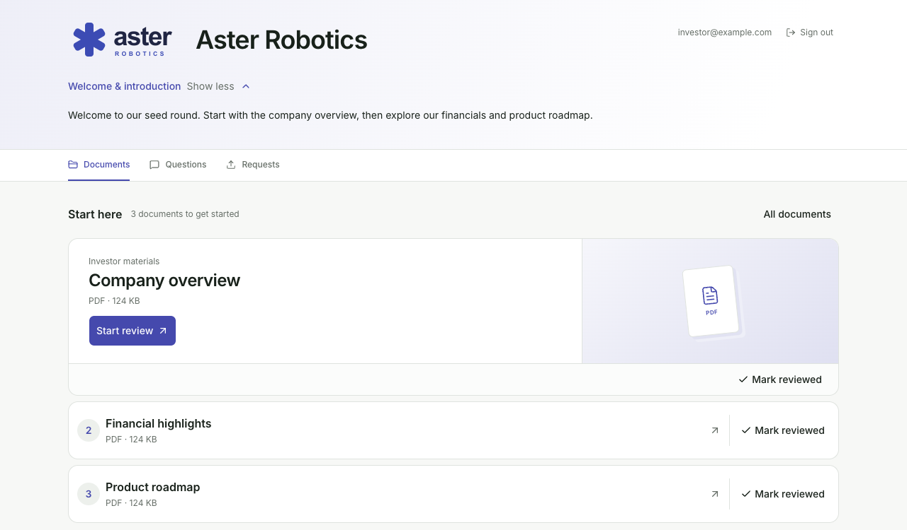
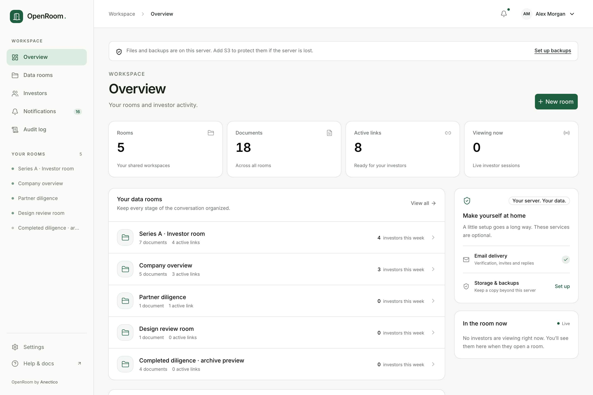

# OpenRoom

A self-hosted data room for fundraising and due diligence. Give each investor a personal link to the documents they can review, answer questions beside the material, and see which pages they spend time on.

**[Run locally](#run-locally) · [Deploy on a VPS](#deploy-on-your-server) · [Read the product guide](docs/using-openroom.md) · [Use the API, MCP or CLI](#api-mcp-and-cli)**



## Share your first room

| Step                      | In the workspace                                                                                                                                                                                         |
| ------------------------- | -------------------------------------------------------------------------------------------------------------------------------------------------------------------------------------------------------- |
| **1. Prepare the room**   | Upload files, organize them into folders, and choose up to six documents for investors to read first. Add your logo, cover and welcome.                                                                  |
| **2. Invite an investor** | Create a personal link. Choose its audience, document group, downloads and expiry. Add a password, email verification or an NDA as needed. Use **Preview as investor** to check the link before sharing. |
| **3. Follow the review**  | See visits and page-level reading time, answer private questions, and request missing files. Investors can resume reading and mark documents reviewed.                                                   |

The reader supports PDFs, images and video. You can upload new versions, publish a shared FAQ, revoke a link, export activity to CSV and freeze a completed room into an archive. [Explore the investor and team workflows](docs/using-openroom.md).

<details>
<summary>View the owner workspace</summary>



</details>

## Run locally

**Requires Node.js 24 or newer and npm.** Clone the repository and prepare a private environment file.

```sh
git clone https://github.com/anectico/openroom.git
cd openroom
npm ci
cp .env.example .env
chmod 600 .env
```

Set the initial owner email and a unique password of at least 10 characters in `.env`.

```dotenv
ADMIN_EMAIL=you@example.com
ADMIN_PASSWORD=replace-with-a-unique-password
```

```sh
npm run dev
```

**[Open the local workspace](http://localhost:5173/admin)** and sign in with those credentials. The owner is created on first start. After signing in, you can remove `ADMIN_PASSWORD` from `.env`. To use a different host or port, set `ORIGIN` to the exact origin and restart.

SQLite and uploaded files live in `./data`. If `OPENROOM_SECRET_KEY` is empty, development generates and reuses `data/dev-secret.key`. Keep both `.env` and `data/` private.

## Deploy on your server

**Initial release candidate.** The local setup above runs from source. The VPS installer requires a published image and deploy files. The release guide includes a drill for testing an unpublished image. [Release guide](docs/contributing/release.md#isolated-clean-local-server).

Use a 64-bit x86 or ARM Linux VPS with at least **2 GB RAM**, space for documents and backups, and ports **80** and **443** open. Once release artifacts are published, run the installer.

```sh
curl -fsSL https://raw.githubusercontent.com/anectico/openroom/main/deploy/install.sh | sudo bash -s -- --email you@example.com --yes
```

Add `--domain rooms.example.com` for your domain, or use the generated `sslip.io` address. The installer sets up Docker if needed, configures HTTPS, and generates the owner password and encryption key. Save the credentials and `OPENROOM_SECRET_KEY` securely. Verify the install with `openroom-server doctor`. [Installation runbook](docs/agents/install.md).

| Service                      | What it does                                                                                                                                                                                        |
| ---------------------------- | --------------------------------------------------------------------------------------------------------------------------------------------------------------------------------------------------- |
| **Application and HTTPS**    | One application container runs OpenRoom, SQLite and Litestream. Caddy serves HTTPS. Use `openroom-server update` and `openroom-server rollback` to manage versions.                                 |
| **File storage and backups** | Local disk works out of the box. Connect S3-compatible storage to keep data off the host. A replica on the same server shares its failure risk. [Storage and recovery](docs/storage-and-backups.md) |
| **Email delivery**           | Share links manually from the start. Connect Resend, Cloudflare or SMTP for verification codes, invitations and notifications. [Email setup](docs/email.md)                                         |

## API, MCP and CLI

The admin UI, REST API, MCP server and CLI use the same member operations, role checks and audit log. Create a key in **Settings → API keys**. Supply it through your client’s secret configuration.

| Interface           | Entry point                          |
| ------------------- | ------------------------------------ |
| Admin workspace     | `/admin`                             |
| REST and OpenAPI    | `/api/v1` and `/api/v1/openapi.json` |
| Streamable HTTP MCP | `/mcp`                               |
| CLI                 | `openroom` from `@anectico/openroom` |

REST and MCP accept `Authorization: Bearer KEY`. For the CLI, set `OPENROOM_URL` and `OPENROOM_API_KEY`. Build the CLI locally, or install with `npm install -g @anectico/openroom` once the package is published. [CLI setup](docs/cli.md#cli).

```sh
openroom get-me
openroom list-rooms
openroom create-room --name 'Investor room'
openroom upload ./documents --room-id ROOM_ID --dry-run
```

## Documentation

| I want to…                                        | Start here                                                                                                                                 |
| ------------------------------------------------- | ------------------------------------------------------------------------------------------------------------------------------------------ |
| Set up a workspace or customize a room            | [Settings and branding](docs/settings.md) · [Environment variables](docs/configuration.md)                                                 |
| Understand investor identity, exports and erasure | [Privacy and retention](docs/privacy.md)                                                                                                   |
| Diagnose a server or restore a backup             | [Operations and recovery](docs/agents/operations-and-recovery.md)                                                                          |
| Prepare a room with an agent                      | [First-room runbook](docs/agents/first-room.md) · [Agent skill](skills/openroom/SKILL.md) · [Agent index](llms.txt)                        |
| Work on the codebase                              | [Stack](docs/contributing/stack.md) · [Operation architecture](docs/contributing/operations.md) · [UI design](docs/contributing/design.md) |

Reading time measures foreground viewing. Watermarks and browser protections discourage casual copying. An investor can still capture a screen or photograph it.

## Contributing

Bug reports, documentation improvements and focused pull requests are welcome. Include reproduction steps, expected behavior and your environment. Remove credentials and investor data from screenshots and logs. Discuss substantial changes in an issue first.

Keep member actions in the shared operation registry and update affected guides and agent runbooks. Keep code explanations in Markdown. Use temporary checks against a real app, SQLite database and files, then remove them before committing. Access, rendering and recovery changes have additional checks in the [release guide](docs/contributing/release.md).

```sh
npm run lint
npm run build
node scripts/generate-cli.ts --check
```

## License

OpenRoom by [Anectico](https://anectico.com) uses the [Functional Source License 1.1, MIT Future License](LICENSE.md) (**FSL-1.1-MIT**). Each version becomes available under MIT on the second anniversary of its release.
