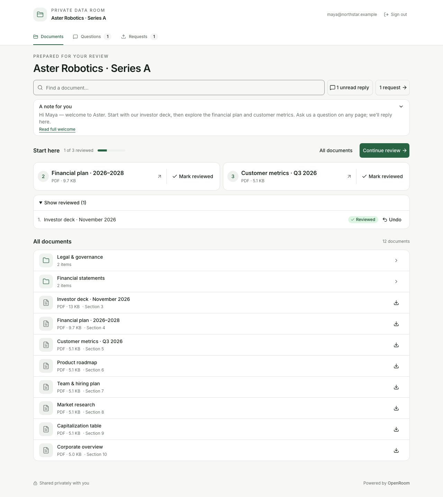
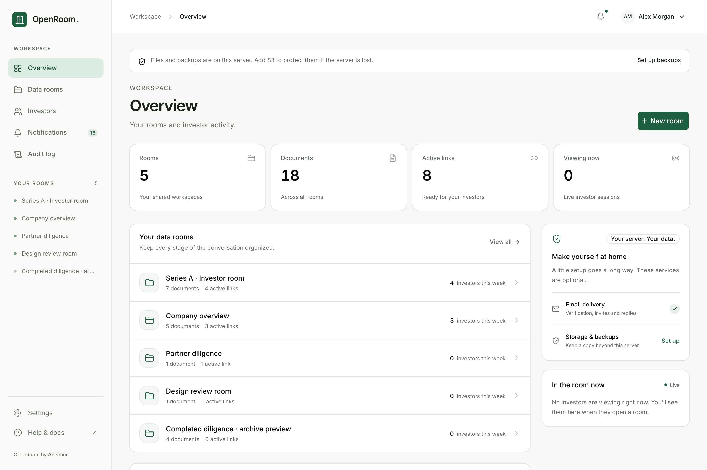

# OpenRoom

**Your documents. Your investors. Your server.**

OpenRoom is a self-hosted data room for fundraising and due diligence. Organize your documents,
share a personal link with each investor, and follow their review through page-level activity,
private questions and file requests.

Built by Anectico. Fair-source under [FSL-1.1-MIT](LICENSE.md).

[Get started](#run-locally) · [Deploy](#deploy-on-your-server) · [Product guide](docs/using-openroom.md) · [API, MCP & CLI](docs/cli.md) · [Contribute](#contributing)



_A fictional Series A room with 12 example documents, a personal investor welcome, one document marked reviewed, a team reply and a file request._

## What you can do

- **Prepare a data room.** Organize files into folders, upload new versions, reorder documents,
  and manage access through groups. Duplicate a room for the next process.
- **Control who gets in.** Create separate investor links with email/domain allow and block lists,
  passwords, expiry, email verification and versioned NDA acceptance. Revoke access when needed.
- **Make the room feel personal.** Use your logo, colour and welcome introduction. Add a
  link-specific welcome and pin up to six **Start here** documents in reading order.
- **Give investors a useful reader.** View PDFs, images and supported videos in the browser with
  identity watermarks. PDFs include text search, thumbnails, zoom and tab-local reading resume.
  Download permissions control individual files and ZIP exports.
- **Help investors pick up where they left off.** Show new or updated documents, unread replies,
  outstanding requests and an explicit review checklist for pinned documents.
- **Keep the conversation with the documents.** Answer private questions about a room, file or
  PDF page; publish shared FAQs; request files with due dates and upload receipts.
- **Understand engagement.** See visits, page-level reading time, document versions and watched
  video ranges. Review investor history and export activity to CSV.
- **Run the workspace with your team or an agent.** Use owner, admin and observer roles, API keys,
  audit logs, notifications and webhooks. The admin UI, REST API, MCP and CLI share one operation registry.
- **Keep control of the data.** Store documents on local disk or optional S3-compatible storage.
  Freeze completed rooms into archives, configure retention, and export or erase investor data.

<details>
<summary>See the owner workspace</summary>



_Example workspace and activity data._

</details>

## Simple to host

OpenRoom runs as one application container with SQLite. The deployment stack adds Caddy for HTTPS;
Litestream runs alongside the app inside its container to replicate the database. There is no
separate database server or queue service to operate.

Email, S3 and webhooks are optional. Without them, you can upload documents, share links manually,
and use the investor room. Email verification codes and email notifications need an email provider.
Local database replicas stay on the same server; use remote storage and the recovery runbook for
protection against losing that server.

**Project status:** initial release candidate. You can run the source locally using the steps below.
The VPS installer and global npm installation require published release artifacts. See the
[release guide](docs/contributing/release.md) for packaging and deployment validation.

## Run locally

You need **Node.js 24 or newer** and npm.

```sh
git clone https://github.com/anectico/openroom.git
cd openroom
npm ci
cp .env.example .env
chmod 600 .env
```

Before the first start, edit `.env` and set:

```dotenv
ADMIN_EMAIL=you@example.com
ADMIN_PASSWORD=replace-with-a-unique-password
```

Use a password of at least 10 characters. Then start the development server:

```sh
npm run dev
```

Open **http://localhost:5173/admin** and sign in. If you use a different host or port, set
`ORIGIN` in `.env` to that exact origin and restart the development server. The initial owner is created once. You can remove `ADMIN_PASSWORD` from `.env` after that first
successful sign-in; changing it later does not reset an existing member's password.

Development keeps SQLite and uploaded files in `./data`. If `OPENROOM_SECRET_KEY` is blank, it creates
and reuses `data/dev-secret.key`. Keep `.env` and `data/` private; both are excluded from Git.
Use the deployment setup below for a publicly accessible instance.

### Share your first room

1. Create a room and upload your documents.
2. Set its branding and welcome, then choose the documents investors should start with.
3. Create an investor link and review its access and download settings. Enable email verification
   only after configuring email delivery.
4. Preview the link, share it, and follow activity and questions from the room's workspace.

Follow the [product guide](docs/using-openroom.md) for the full workflow, or use the
[first-room agent runbook](docs/agents/first-room.md).

## Deploy on your server

The installer targets a Linux VPS with a 64-bit x86 or ARM CPU, at least **2 GB RAM**, and enough disk
for documents, exports and backups. Ports 80 and 443 must be reachable. It installs Docker if needed
and uses Docker Compose v2.

**Once a release image and its deploy files are published**, run:

```sh
curl -fsSL https://raw.githubusercontent.com/anectico/openroom/main/deploy/install.sh | sudo bash -s -- --email you@example.com --yes
```

Add `--domain rooms.example.com` to use your domain. Without one, the installer uses an address
based on the server's IP under `sslip.io`. Only the owner email is required; the installer generates
the initial password and encryption key and configures HTTPS.

Save the generated credentials and `OPENROOM_SECRET_KEY` securely: recovery needs that key.
After installation, check the server with:

```sh
openroom-server doctor
```

Use `openroom-server update` and `openroom-server rollback` to manage installed versions.
See [installation](docs/agents/install.md), [configuration](docs/configuration.md), and
[storage and recovery](docs/storage-and-backups.md) before deploying. To validate an unpublished
image, follow the [isolated local-server drill](docs/contributing/release.md#isolated-clean-local-server).

## API, MCP and CLI

Every member operation is defined once, with shared validation, authorization and audit behavior.
You can use the same workspace through:

| Interface           | Where to find it                     |
| ------------------- | ------------------------------------ |
| Admin UI            | `/admin`                             |
| REST API            | `/api/v1`                            |
| OpenAPI description | `/api/v1/openapi.json`               |
| Streamable HTTP MCP | `/mcp`                               |
| CLI                 | `openroom` from `@anectico/openroom` |

Create an API key in **Settings → API keys**. REST and MCP clients authenticate with
`Authorization: Bearer KEY`. Supply credentials through your client’s secret configuration.

After the CLI package is published:

```sh
npm install -g @anectico/openroom
```

Configure `OPENROOM_URL` and `OPENROOM_API_KEY`, then:

```sh
openroom get-me
openroom list-rooms
openroom create-room --name 'Investor room'
openroom upload ./documents --room-id ROOM_ID --dry-run
```

The CLI can also be [built and installed locally](docs/cli.md#cli). For agents, start with the
[OpenRoom skill](skills/openroom/SKILL.md) and [documentation index](llms.txt).

## Documentation

| Topic                                             | Guide                                                        |
| ------------------------------------------------- | ------------------------------------------------------------ |
| Rooms, sharing, reading, questions and requests   | [Using OpenRoom](docs/using-openroom.md)                     |
| Branding, members, keys and workspace options     | [Settings](docs/settings.md)                                 |
| Environment variables                             | [Configuration](docs/configuration.md)                       |
| Verification codes, invitations and notifications | [Email](docs/email.md)                                       |
| Local disk, S3, backups and restoration           | [Storage and backups](docs/storage-and-backups.md)           |
| Investor exports, erasure and retained records    | [Privacy](docs/privacy.md)                                   |
| Automation and client examples                    | [CLI and MCP](docs/cli.md)                                   |
| Updates, diagnostics and recovery                 | [Operations runbook](docs/agents/operations-and-recovery.md) |
| Packaging and release checks                      | [Release guide](docs/contributing/release.md)                |

Reading time estimates foreground viewing; it does not prove a document was understood. Watermarks
and browser protections discourage casual copying but cannot prevent screenshots or photographs.
See the product and privacy guides for session identity, download and retention behavior.

## Contributing

Bug reports, documentation improvements and focused pull requests are welcome. For a bug, include
reproduction steps, expected behavior and your environment; remove credentials and private investor
data from logs and screenshots. Discuss substantial changes in an issue before implementing them.

The stack is SvelteKit 3, Svelte 5, TypeScript, Tailwind CSS 4 and shadcn-svelte, with SQLite/Drizzle,
Better Auth and FlyDrive on the server. See the [stack](docs/contributing/stack.md),
[operation architecture](docs/contributing/operations.md) and [UI design](docs/contributing/design.md).

| Directory                      | Purpose                                                |
| ------------------------------ | ------------------------------------------------------ |
| `src/routes/`                  | Pages, REST routes and MCP endpoint                    |
| `src/lib/operations/`          | Shared member operations                               |
| `src/lib/server/`              | Application logic, storage and database access         |
| `src/launcher/`                | Startup, replication, restore and rollback             |
| `migrations/`                  | Database migrations                                    |
| `cli/`                         | Independent CLI package and generated catalog          |
| `deploy/`                      | Installer, Compose stack and server management command |
| `docs/` and `skills/openroom/` | User, contributor and agent documentation              |

Before submitting a change:

```sh
npm run lint
npm run build
node scripts/generate-cli.ts --check
```

Keep member actions in the operation registry so all interfaces stay consistent. Update the relevant
docs and agent runbooks with user-facing changes. This repository keeps explanations in Markdown
rather than code comments and does not commit tests: use temporary checks against a real app,
SQLite database and files, then remove them. Access, rendering and recovery changes require the
corresponding checks in the [release guide](docs/contributing/release.md).

## License

OpenRoom by Anectico is fair-source under the
[Functional Source License 1.1, MIT Future License](LICENSE.md) (**FSL-1.1-MIT**).
Each version becomes available under MIT on the second anniversary of its release. See the license
for the terms that apply before and after that date.
