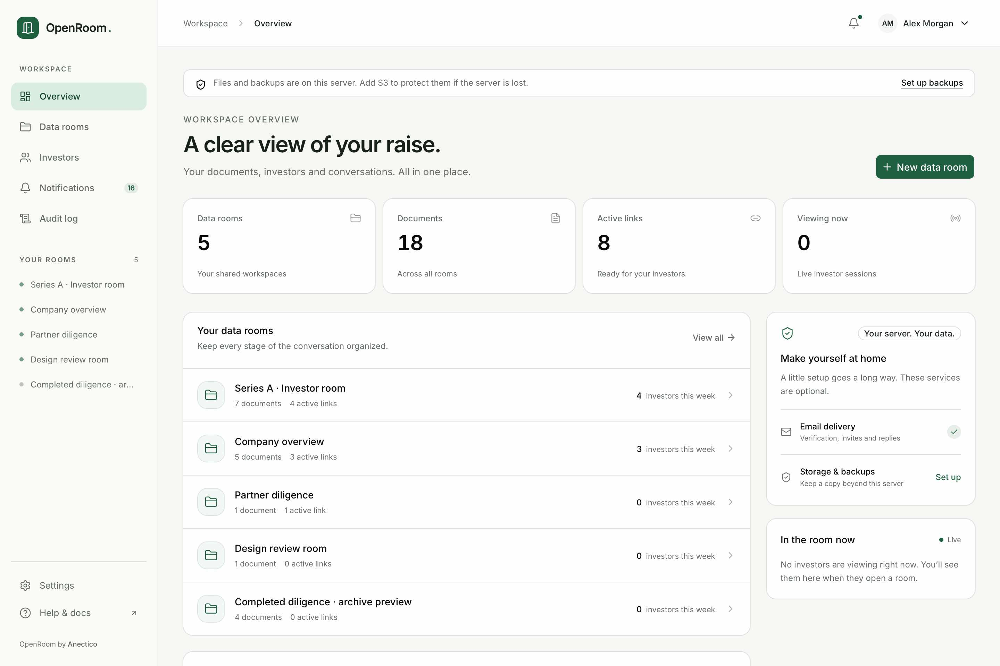
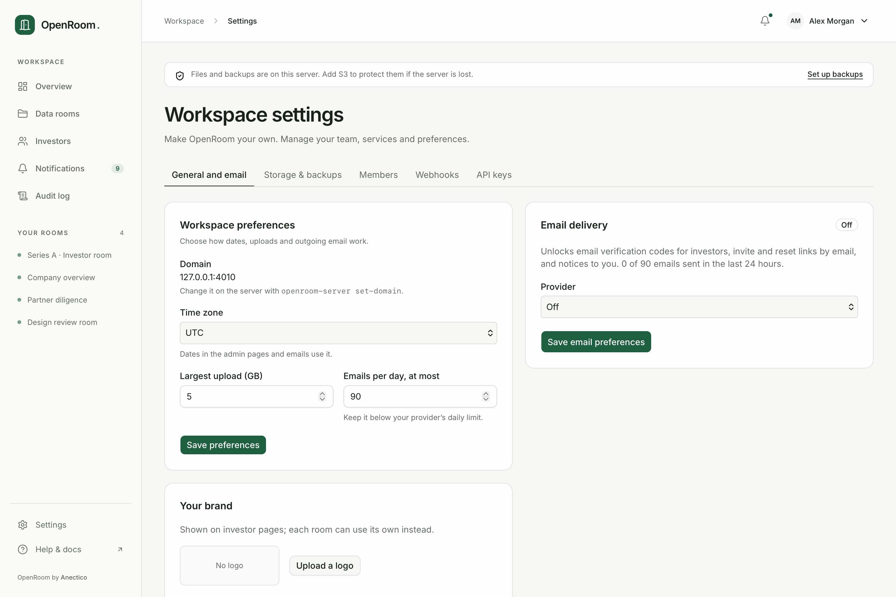
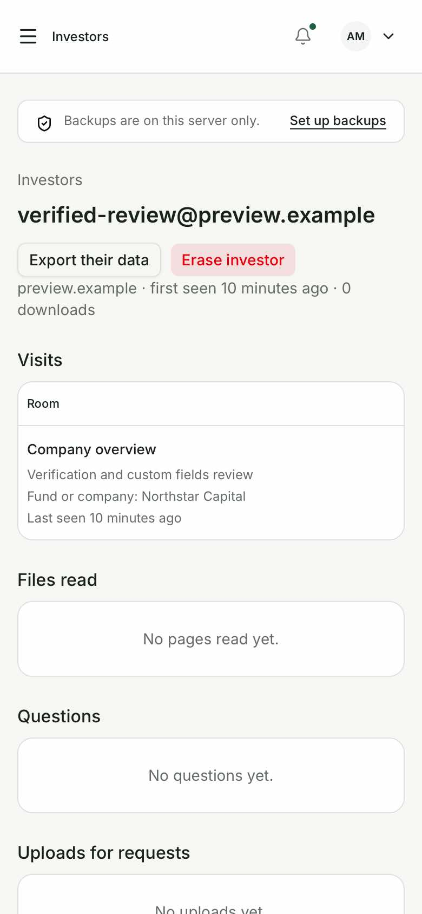
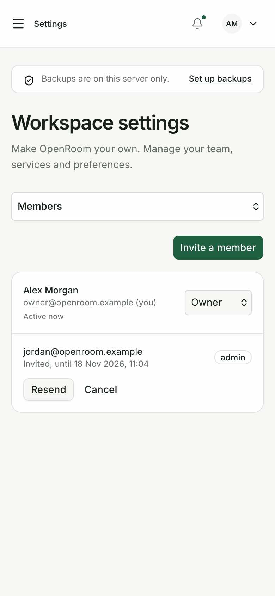
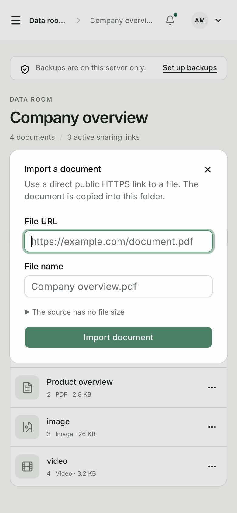
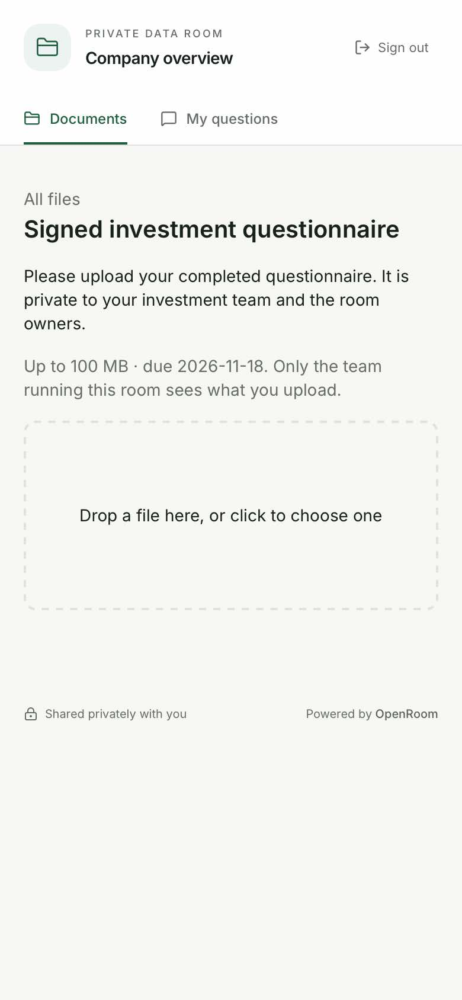
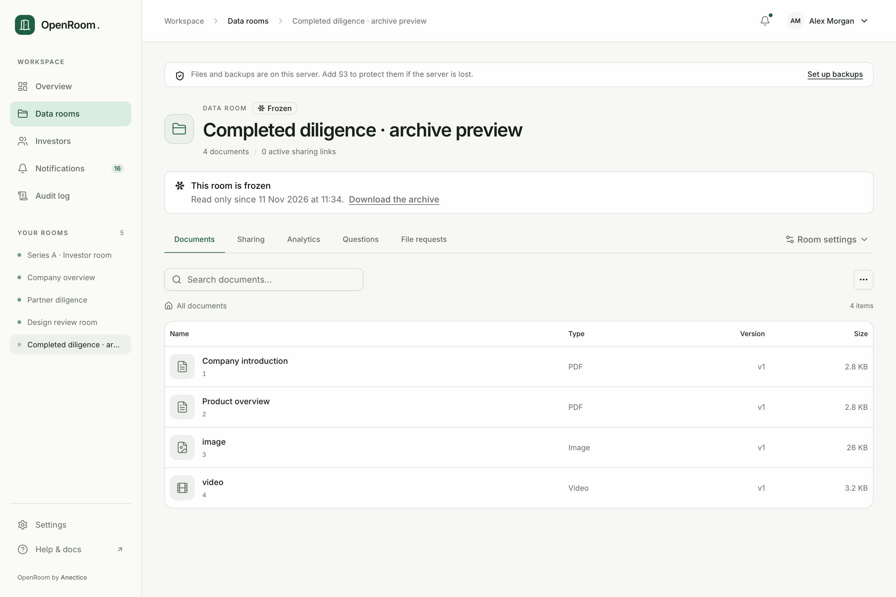
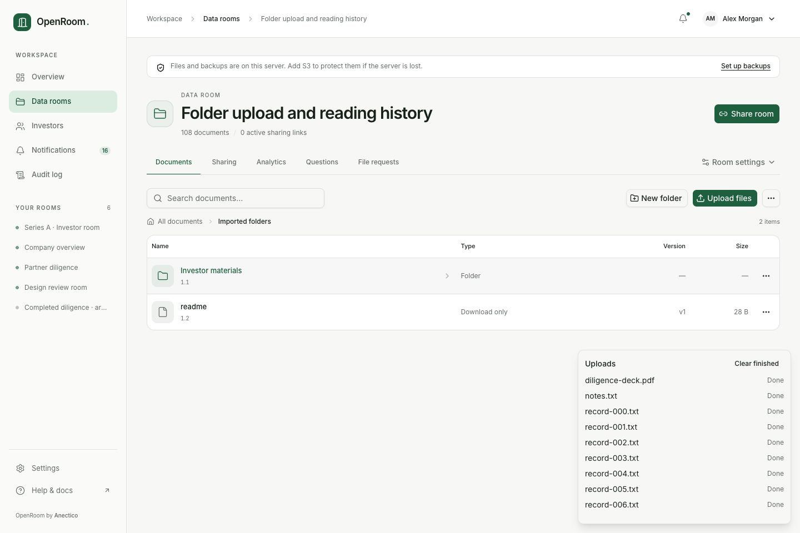
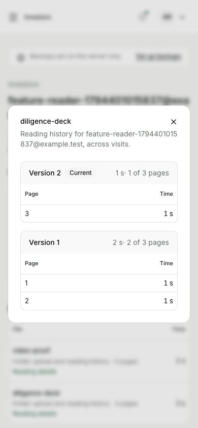
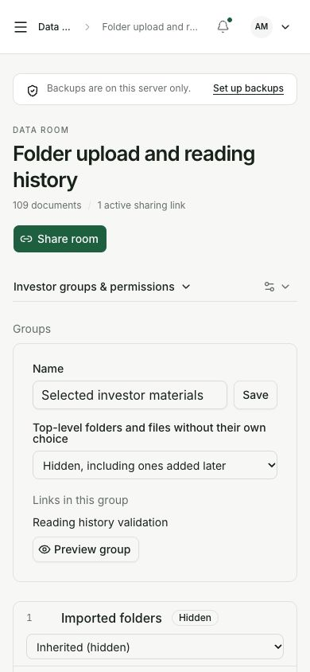

# UI and UX visual validation

The implementation was reviewed as rendered pages in the browser, using screenshots at 1440×960
and 390×844 CSS pixels. Fixture documents and identities are disposable examples. This was visual
inspection and interaction validation, not just a source-code review. Native screenshots are in
[ui-release](ui-release/) and the earlier [ui-r1](ui-r1/) set.

## Changes

- Consistent green brand, restrained backgrounds, typography, spacing, navigation and focus states.
- Workspace overview with room list, recent activity, viewing-now and optional setup status.
- Room navigation separates documents, sharing, analytics, questions and requests. Settings remain
  available from a clearly labeled menu; phone navigation uses compact selectors.
- Searchable folder browsing, file type icons, upload progress, direct sharing-copy actions and
  scrolling link editors with reachable controls.
- Phone tables retain essential information and move secondary values below it. Member, key, audit,
  investor and question layouts no longer rely on clipped desktop columns.
- The last production pass found investor-detail emails pushing actions off-screen. The heading,
  actions, visits and reading tables were revised and visually checked again with the long address.
- Settings use readable cards; the phone selector always displays the current section. Storage
  moves expose verification progress, failure, retry and cancellation, plus a destination dialog.
- URL imports have a compact form, pending state and inline errors. A private URL was rejected, then
  a public HTTPS document imported successfully through the actual production UI.
- Investor entry uses a focused card for password, email, delivered code, custom fields and NDA.
  The full local SMTP/code/fields flow and a signed NDA were completed in the browser.
- PDF paging, jump/zoom, watermark and private question dialog were reviewed on phones. Image/video
  viewers, real video playback and requested-file upload were also exercised.
- The feature recheck adds native folder drops, a group-preview action and a per-investor reading
  dialog with page/version history. Fresh desktop/phone screenshots were inspected after exercising
  the real production UI. The native-drop drill used 108 actual local files and checked every hash.

## Coverage and evidence

| Surface                       | Visual checks / interaction                                                                      |
| ----------------------------- | ------------------------------------------------------------------------------------------------ |
| Login and password invitation | Focused cards, labeled fields, mobile fit; authenticated login redirect also checked             |
| Overview and rooms            | Desktop/phone layout, creation, search and navigation                                            |
| Documents                     | Folder navigation, upload and version actions, import dialog, index/zip and frozen archive state |
| Sharing                       | Personal link rows, copying, link creation/editing, restrictions and phone dialog scrolling      |
| Analytics and investors       | Filters/tables, long identities, investor detail, visits/fields and reading summaries            |
| Questions                     | Private thread, reply form, FAQ list/editor and phone actions                                    |
| File requests                 | Member request list/dialog, investor request screen and actual file upload success               |
| Groups                        | Default and inherited permissions, nested document list and phone controls                       |
| NDA                           | Editor/version history, rendered acceptance text and signed entry                                |
| Room settings                 | Name/welcome, branding, duplicate/freeze/delete and frozen archive banner                        |
| Workspace settings            | General/email, branding, storage/move, members/invites, webhooks and keys                        |
| Account, notices and audit    | Forms, preferences, readable rows, filters and CSV action                                        |
| Investor room                 | Search, file list, FAQ, questions, request, PDF/image/video and watermark                        |

Fresh production tabs were used for final validation; the final reloads had no console errors or
failed resources. One initial overview load recorded an opaque browser `Script error.` without a
stack or failed request; it did not recur on reload. During iterative development, old tabs could hold stale build assets.
Those were reloaded against the finished production server before accepting screenshots. Native
background tabs can suspend animations at their first frame; finite animations were completed
through the browser animation API to capture their stable rendered result. No screenshot was
retouched or reconstructed. The Chromium feature-recheck screenshots use its native screenshot
option to complete finite animations before capture, with the same stable-state purpose.
