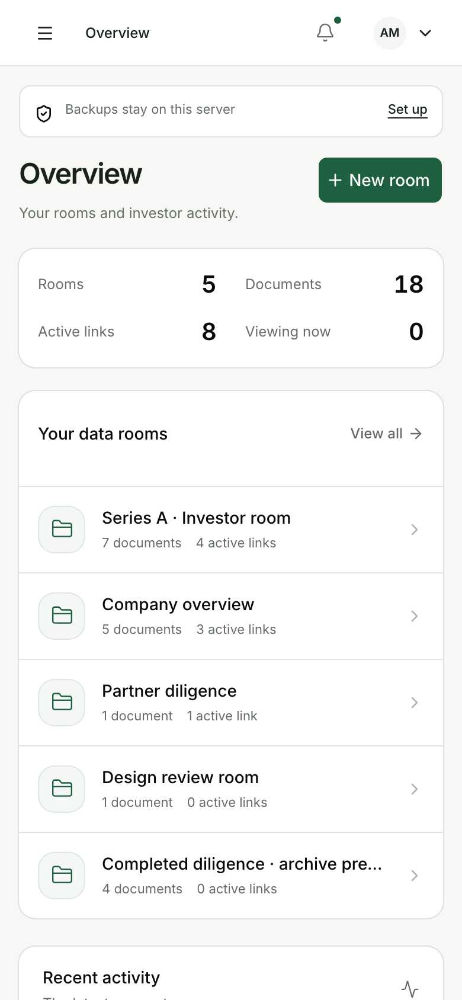
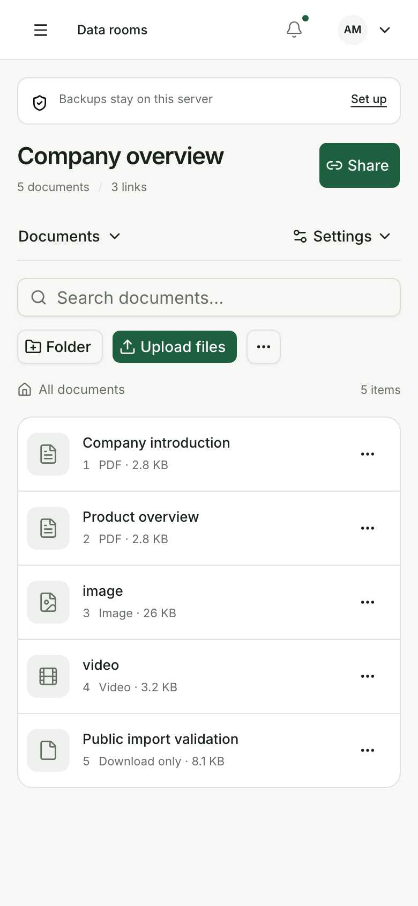
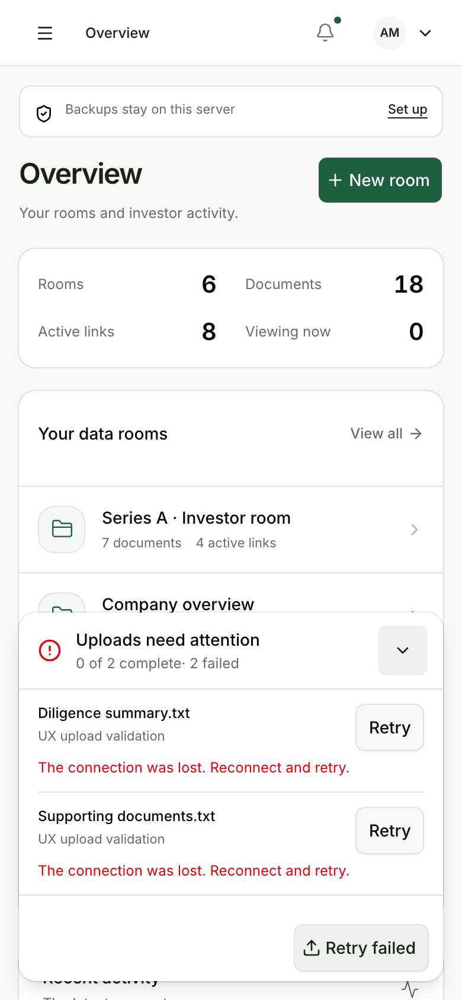
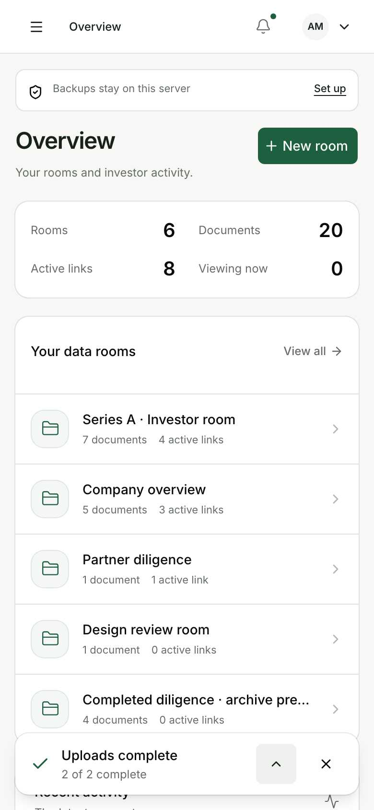

# UX refinement and visual review

Reviewed the rendered application and interactions on 11 November 2026. Changes remain local and
uncommitted. Screenshots use the existing disposable rooms and identities; no real investor content
was used. The existing green, neutral and Inter/shadcn-svelte design system is retained.

## Findings and changes

| Finding from rendered pages                                                                       | Improvement                                                                                                            |
| ------------------------------------------------------------------------------------------------- | ---------------------------------------------------------------------------------------------------------------------- |
| Phone overview used most of the first screen for the heading and four large statistics cards      | A shorter functional heading and a single readable summary put the room list earlier                                   |
| Room pages repeated a truncated room name in the header, then used a large title/action block     | One readable room title, Share beside it, compact metadata and labeled section/settings controls                       |
| Routine backup guidance competed with primary work; critical warnings looked similar              | Compact local-backup notice; replication/disk failures retain prominent alert treatment                                |
| Navigation icons and document titles offered small touch areas                                    | 44 px workspace navigation, document primary actions, row menus and room navigation                                    |
| The phone document list spent space on a redundant visual header                                  | Header remains available to assistive technology; column widths preserve readable document names                       |
| Upload feedback disappeared outside room pages and left a large completed list open               | Workspace-level tray, counts/byte progress, destinations, minimize/expand, automatic completion collapse and dismissal |
| A real offline upload triggered page invalidation into an error screen and removed retry controls | Failed/offline uploads keep their status and retry controls; successful online uploads refresh the page data           |
| A network error said “Failed to fetch”                                                            | Plain-language connection-loss guidance                                                                                |

At a 390 × 844 CSS viewport, the first room action begins at approximately y=411 and the first
document action at y=401. All five sample rooms and all five sample documents fit in their
respective first screens. Desktop layouts keep the sidebar, full metadata and larger metrics.

## Real verification

The throwaway browser script exercised the production server, real SQLite and real disk uploads:

- 33 responsive, navigation, focus, sharing and upload checks passed at 320, 390, 768 and 1440 px.
- No horizontal page overflow; phone primary actions meet their 44 px targets. Escape restores
  navigation-trigger focus. The desktop sidebar does not duplicate the phone menu trigger.
- The sharing dialog keeps its save controls inside the phone viewport.
- Two real files were uploaded under throttled networking, the browser went offline, and the tray
  stayed available after navigating to Overview. Retry recovered both files; downloaded SHA-256
  values matched their originals. Dismissing the receipt left both documents intact.
- No production JavaScript exceptions occurred. Network failures were intentional in the offline
  drill. Browser screenshot capture completed finite animations before capturing stable states.
- Production build and lint passed, including zero Svelte errors/warnings and the no-comments check.

The separate 30-bug review finished before final validation. Its changes were preserved, and this
pass does not change server authorization, storage schemas or migrations. Earlier coverage remains
in the [bug-fix record](2026-11-11-bugfixes.md) and [feature coverage](2026-11-11-feature-coverage.md).

## Before and after

Native screenshots use the same CSS viewport sizes and a device pixel ratio of 2. No images were
retouched or reconstructed.

| Screen           | Before                                              | After                                             |
| ---------------- | --------------------------------------------------- | ------------------------------------------------- |
| Phone overview   | [Before](ui-refinement/before-overview-phone.jpg)   | [After](ui-refinement/after-overview-phone.jpg)   |
| Phone documents  | [Before](ui-refinement/before-documents-phone.jpg)  | [After](ui-refinement/after-documents-phone.jpg)  |
| Desktop overview | [Before](ui-refinement/before-overview-desktop.jpg) | [After](ui-refinement/after-overview-desktop.jpg) |

Additional captures: [desktop documents](ui-refinement/after-documents-desktop.jpg),
[phone sharing](ui-refinement/sharing-phone.jpg), [active uploads](ui-refinement/uploads-active-phone.jpg).
