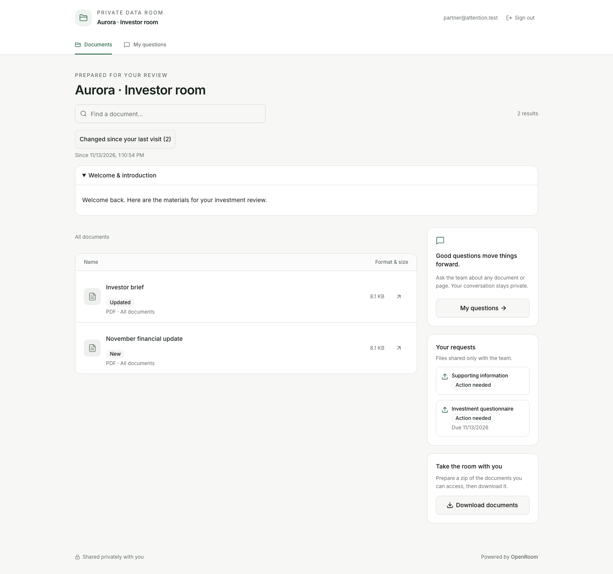
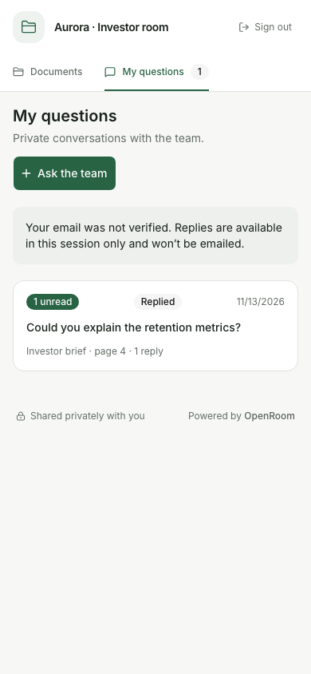
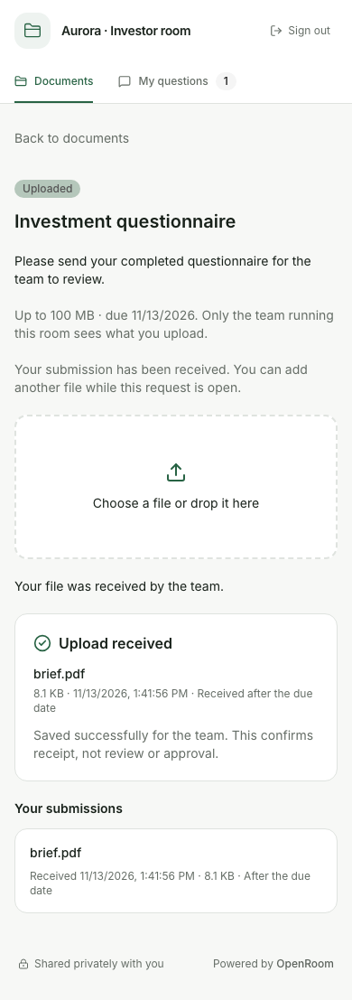
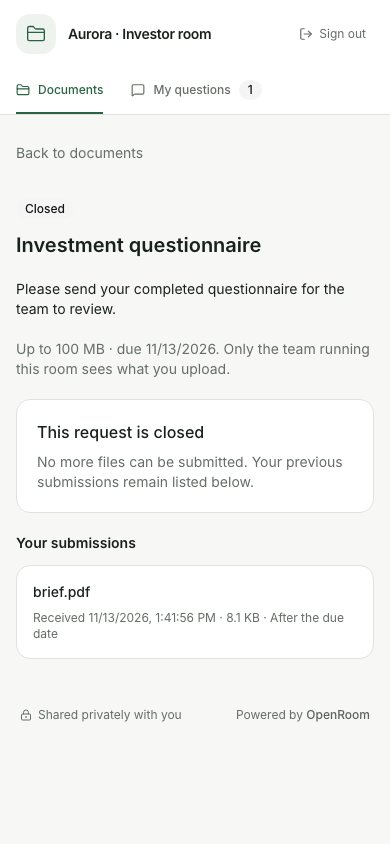
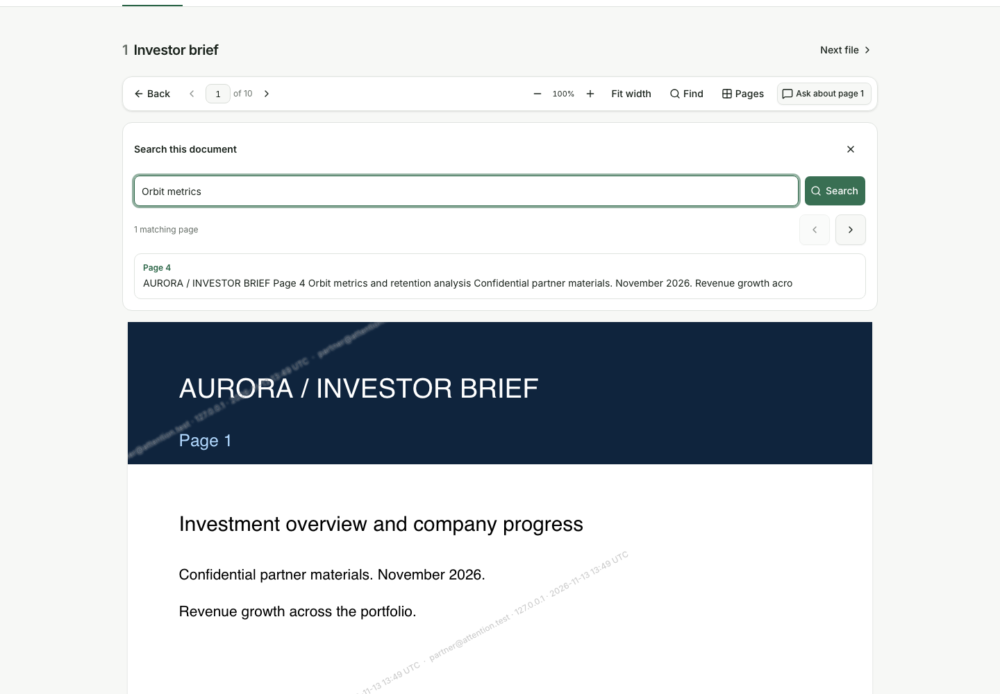
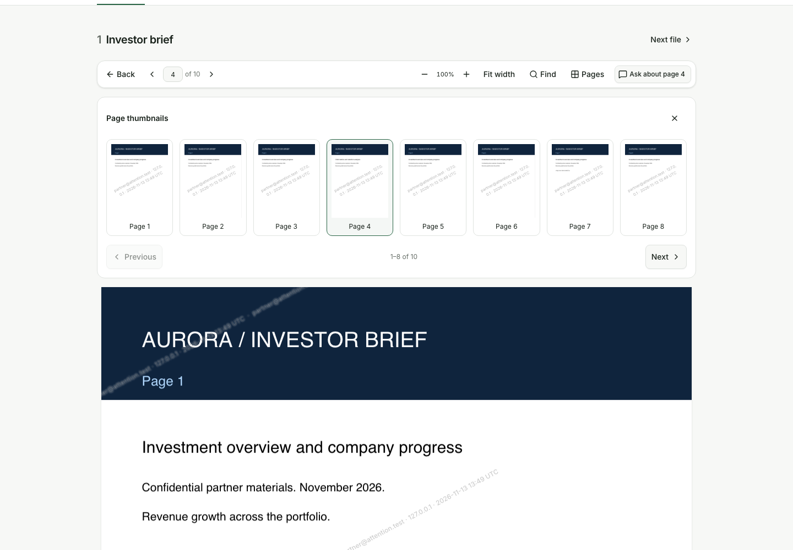
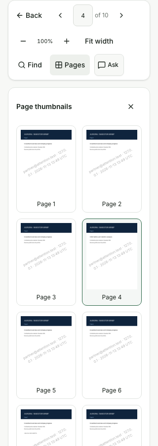

# Investor catch-up and document tools — 13 November 2026

Implemented four investor improvements in the local OpenRoom checkout:

1. **Document changes:** New/Updated badges and a changed-document filter that composes with title
   search and survives reader navigation. The first visit establishes a baseline. Returning after
   30 minutes away from the document list, or entering a new verified session, compares with the
   previous visible-file snapshot. Permissions still determine every result.
2. **Unread replies:** My questions shows total and per-conversation unread counts. Visible team
   replies are marked with their exact message IDs. Offscreen replies stay unread; GET requests
   alone do not mark anything. Last-author status remains separate.
3. **Request receipts:** Action needed, Uploaded and Closed states; a successful upload receipt;
   submission history after reload and closure. Receipt means delivery, not review or approval.
4. **PDF tools:** text search, page results and highlighting, thumbnails in groups of eight,
   selectable text layers, and keyboard Find. Full pages and thumbnails retain watermarks.

## Verification

Validation used the built app through `src/server/index.ts` on a disposable local origin, real
SQLite databases and disk storage, owner operations through authenticated admin endpoints, and
Chromium. No app modules were mocked. Test scripts were temporary and are not committed.

The browser fixture contained generated ten-page PDFs with known text, literal HTML-like text,
a no-text PDF, restricted documents, multiple investor sessions, questions and file requests.
The unverified investor entered through the real email gate. Verified sessions for identity-boundary
checks were created through the production session helper against the same real database; this pass
was not an email-delivery test. Elapsed visit/due timestamps were adjusted in disposable SQLite
fixtures to exercise returning visits and late receipts without waiting 30 minutes.

Coverage includes:

- First-visit behavior; New/Updated counts; hidden files; old newly granted files; version rollback;
  rename-only changes; combined filters; return navigation; unverified-session isolation.
- Verified-session continuity; private conversation boundaries; exact read IDs; later replies staying
  unread; long and offscreen messages; same-origin enforcement; blocks; new NDA requirements;
  member previews producing no investor history.
- Actual upload bytes and completion; late receipts; reload; request navigation; verified and
  unverified submission privacy; closed history; closure before bytes and between bytes and finish;
  unauthorized closed group requests.
- PDF case-insensitive search; result navigation; no results; keyboard focus; text selection;
  zoom alignment; bounded thumbnail rendering and pagination; watermarking; literal text handling;
  document switching; no-text guidance; responsive layouts at 320, 390, 768 and 1440 pixels.
- Investor data export and erasure, including both verified records and unverified-session records.
- Additive migration `0013_investor_attention`, pre-upgrade snapshot, preserved document bytes and
  decryptable secrets, old-journal refusal, real launcher rollback with Litestream from the cached
  application image, restored schema, retained replaced database, replica CURRENT and SQLite integrity.

98 scenario assertions passed across six groups. Named assertions are recorded in
[verification results](ui-attention-2026-11-13/verification-results.json).
`npm run lint`, the production build, generated CLI freshness and `git diff --check` passed.
Svelte checking reported zero errors and zero warnings; the no-comments check passed.

## Visual review and fixes

Screenshots were opened and inspected visually, including desktop document changes, mobile unread
questions and receipts, closed requests, desktop search/selection/zoom, and narrow PDF tools.
Browser testing and visual review verified these corrections:

- Upload receipts persist through data refresh and reset only when changing request/session.
- Long replies can become read when part of them is visible, without requiring a fixed percentage
  of a potentially very tall message to fit on screen.
- Resizing a PDF retains the open tools panel instead of scrolling away to a page.
- Thumbnail previews also carry the investor watermark, and keyboard Find focuses its input.

## Scope and limits

PDF search uses embedded text and does not provide OCR. Text layers expose the PDF's text order;
they do not repair document tagging or guarantee a particular screen-reader reading order. Selection
and accessible DOM text were checked, but a native screen-reader/device matrix was not run. Search
returns matching pages, caps results at 500 pages and caches at most 200 extracted page strings.

The changed-document baseline is a room-list visit snapshot, not proof that the investor read each
file. Unread markers are investor UI state, not an owner-visible read receipt. No additional owner
operations or external services were introduced. A schema rollback restores the pre-upgrade snapshot;
the replaced database is retained for recovery, as in the existing launcher workflow.

This is local implementation and verification; no live deployment was performed.
