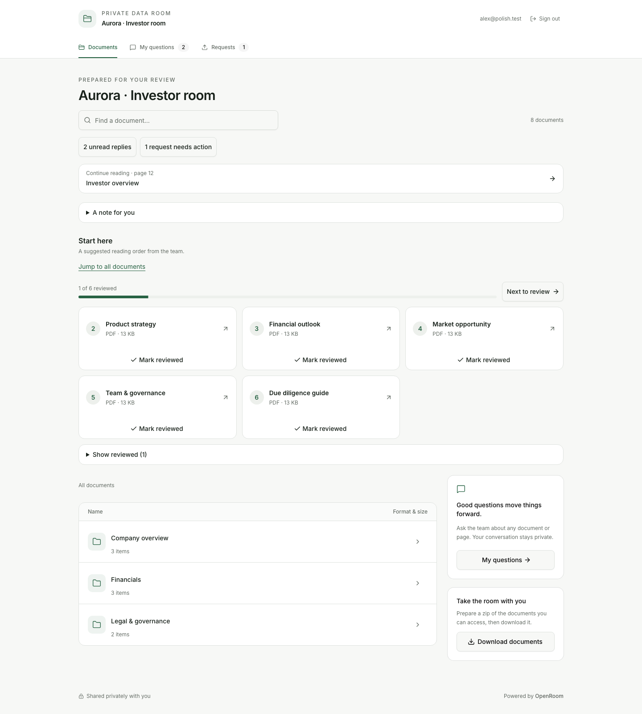
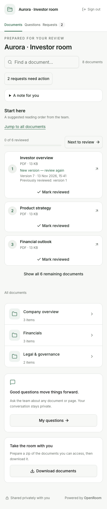
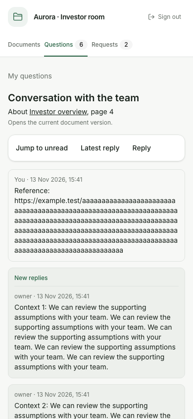
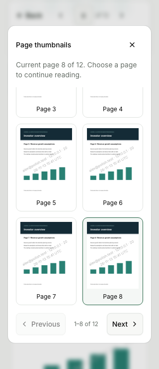
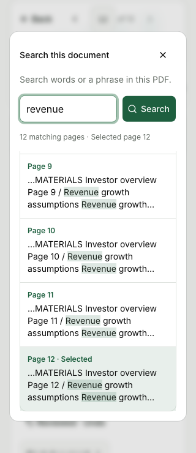
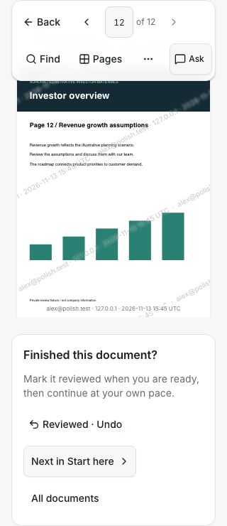
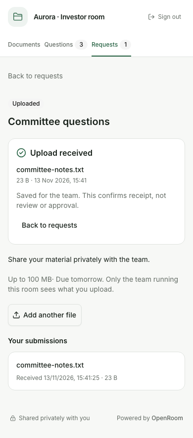
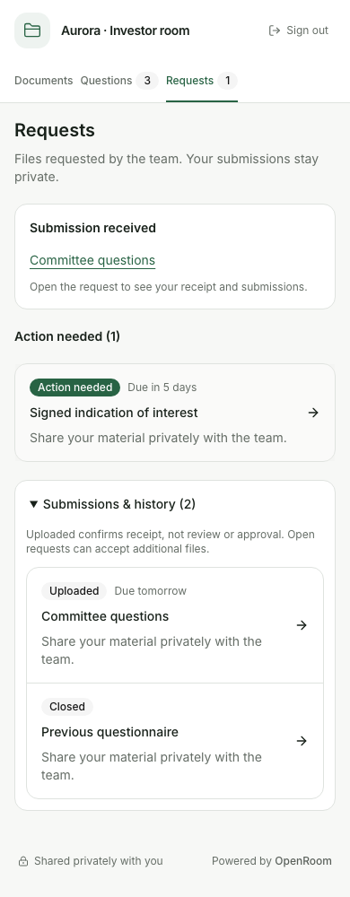

# Investor completion polish — 13 November 2026

Implemented all six recommendations from the [investor UX recheck](2026-11-13-investor-ux-recheck.md).

## Changes

1. Welcome disclosures retain investor choices through review saves and background refreshes.
   Start here emphasizes remaining documents in the team's order, moves reviewed items into a compact
   disclosure with Undo, and provides a direct jump to all documents. Saved return-scroll positions
   no longer override that jump. Review actions retain keyboard focus at the progress summary.
2. Conversations wrap long URLs and unbroken text. Sticky unread/latest/reply shortcuts make long
   threads navigable; a recovered draft changes Reply to Resume draft. A divider retains the location
   of new replies after visible messages are marked read. List previews are limited to three lines.
3. PDFs end with explicit review, next-document and return actions, preserving the existing guide and
   browsing context. Opening or finishing a PDF still does not automatically mark it reviewed.
4. PDF dialogs reveal the current thumbnail or selected search result on reopening, retain internal
   scrolling and restore trigger focus on close. Positioning uses panel-relative geometry so dialog
   animations and asynchronously rendered thumbnails do not leave the selection clipped.
5. A changed version explains why review is needed again, with current version/date and the previously
   reviewed version. This works independently of the visit baseline. Conversation references explicitly
   say they open the current document version.
6. Upload receipts precede the upload action and survive reload. Add another file is secondary and
   disappears when a request closes. Returning to Requests highlights an authorized own submission
   and expands history; a subsequent manual collapse survives background refreshes.

There are no new dependencies, schema changes or owner operations. Existing review writes, access
checks, request upload endpoints and operation registry remain the authority. User documentation,
contributor notes, agent runbook, skill and llms.txt were updated.

## Validation

The production build ran through the real Node 24 server with disposable SQLite and disk storage.
Owner operations created eight twelve-page PDFs, folders, six pins, a personalized investor link,
requests, replies and replacement versions. Investor interactions used real browser sessions and HTTP
endpoints; application modules were not mocked.

- **45 browser checks:** welcome persistence, review/undo and focus, compact reviewed items, new-version
  explanations, PDF completion, page 8 thumbnails, search result 12, resize and Escape focus, long-text
  wrapping, conversation shortcuts and draft recovery, receipts and additional uploads, validated
  return summaries, and home/conversation widths at 320, 390, 768 and 1440 px.
- **14 boundary checks:** own review metadata, isolation between unverified sessions and verified
  investors, sharing for the same verified identity, preview isolation, stale-version rejection,
  hidden-file/read denial, removed pins, own-submission isolation, forged empty receipt hints,
  missing-session denial, version restoration and SQLite integrity.
- **9 final-build checks:** saved-scroll anchor navigation, keyboard welcome preference, submission
  history expansion/manual collapse, retained receipt after closure, removal of closed upload
  controls, narrow PDF completion and actual next-guide navigation, with no browser JavaScript errors.
- `npm run lint` passed: Biome, svelte-check with zero errors/warnings, and no-comments verification.
- `npm run build` passed.

Sixteen screenshots are retained below; thirteen key images were opened for visual inspection in the
final review, including desktop and 320 px home, conversation, PDF panels, completion and open/closed
request receipts. Long conversations stay within the mobile viewport. In the comparable 390 px upload
fixture, the receipt now begins at 279 px, versus 659 px in the preceding recheck.

This is focused validation of these changes, not a rerun of every earlier regression or the clean-server
release runbook. Chromium was used; native devices, other browser engines and a screen-reader audit
were not covered. No deployment was performed. Disposable test scripts, credentials, server and data
were removed after preserving the evidence.

## Evidence

[Browser results](ui-completion-polish-2026-11-13/browser-results.json),
[boundary results](ui-completion-polish-2026-11-13/boundary-results.json), and
[final-build results](ui-completion-polish-2026-11-13/final-results.json).

