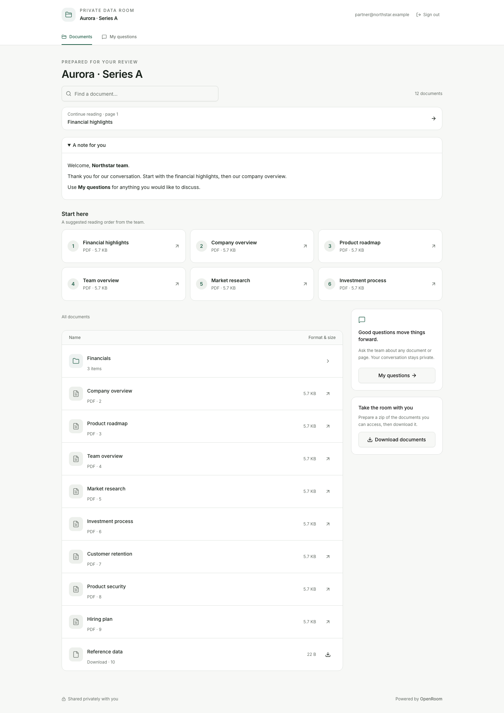
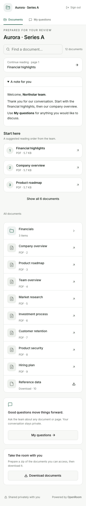
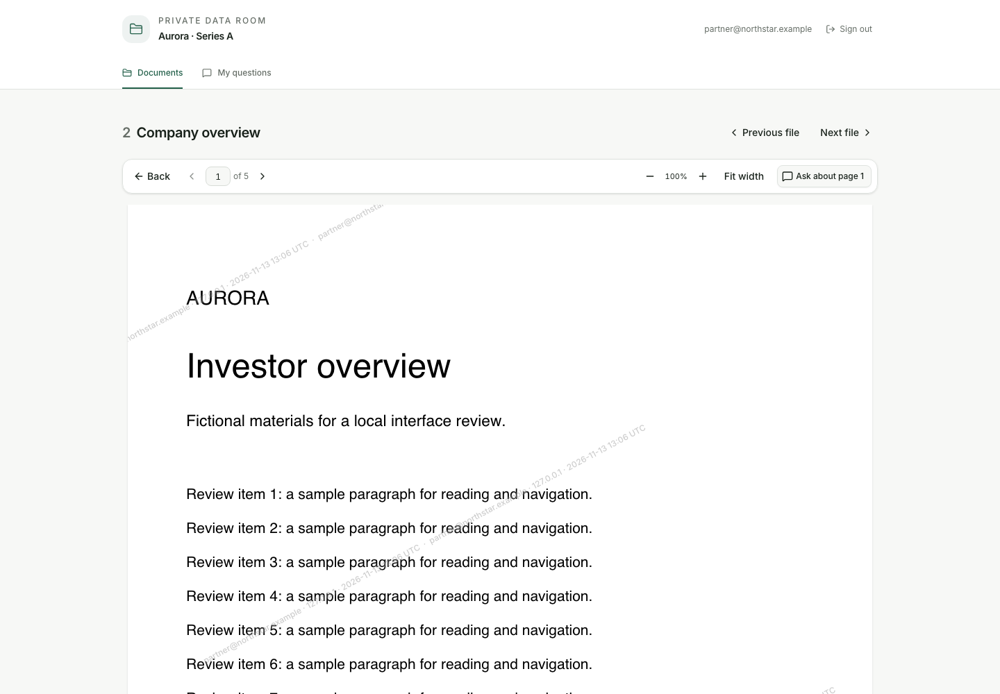
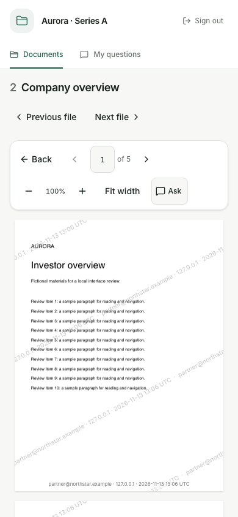
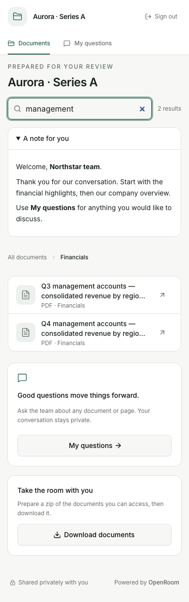
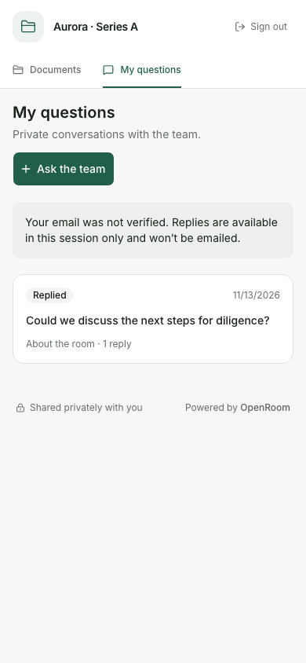
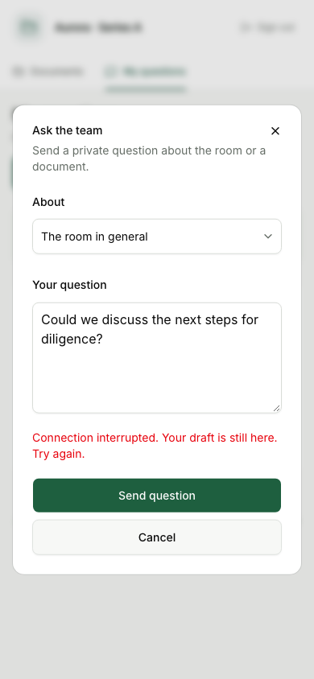
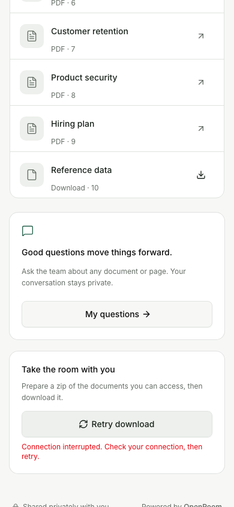

# Investor navigation, reading and questions

Date: 2026-11-13. Implemented and checked locally against the production build. No deployment,
publication, new dependencies or database migration. All owner operations remain on their existing
surfaces; these are investor controls using existing authorized endpoints.

## Changes

1. Readers opened from Start here follow the saved, permission-filtered order, including a
   download-only card when that file is next. Returning restores the document folder, search and scroll
   position. Normal readers retain normal document order. The PDF Back action stays in its toolbar.
2. Search is immediately below the room heading. Phones show three compact pinned cards and an
   explicit Show all/Show fewer action; desktop keeps the full ordered grid.
3. Search reports the result count. Document titles can use two lines, retain the full title as a
   hover title, and show their containing folder path in search results.
4. My questions has an Ask the team composer for general or permitted-document questions. Awaiting
   answer/Replied reflects the last author, not an unread count. Failed submissions keep the draft;
   private conversation boundaries remain enforced. Invalid or no-longer-visible context is rejected.
5. PDFs restore their page and offer Continue reading and Fit width. Up to 50 file/version/page
   positions are kept in tab session storage, with a separate namespace for each investor session.
   No titles, contents or email addresses are stored. New versions start fresh, unavailable files are
   excluded, member previews do not save progress, and blocked storage does not prevent reading.
6. ZIP preparation shows connection errors and retry. Retry after a polling failure resumes the
   same job; a ready archive has an explicit Download zip action. Individual requests time out and
   leaving the component cancels polling. Server permission checks still protect the download.

## Checks

79 throwaway checks passed using a real local SQLite database, disk objects, generated five-page
PDFs and actual investor sessions. Tests were outside the repository and removed after completion.
No external email service was configured and no external messages were sent.

- 41 main-flow checks: compact/expanded pins, desktop grid, pinned Previous/Next, PDF reload/resume,
  Fit width, folder/search/scroll restoration, URL reload, search counts and paths, hidden-pin exclusion,
  last-pin boundary, new versions, general/document questions, offline drafts, team reply states,
  conversation isolation, forbidden context and cross-origin submission, ZIP start failure, interrupted
  polling, retry without a duplicate job, actual ZIP bytes, and layouts at 320/390/768/1440 pixels.
- 27 edge checks: rapid typing and browser Back; storage contents, malformed records, inaccessible
  IDs and stale versions; separate links and fresh sessions; live permission removal; storage blocked
  by the browser; member previews; bounded local return routes; reader widths and small-phone dialog
  bounds; revoked-session refusal; no uncaught browser errors.
- 11 transition checks: client navigation between sessions while reusing the same route, including
  the same PDF; independent resume pages and cleared question drafts; download-only pinned entries;
  plain-text rendering of investor questions; Awaiting answer after an investor follow-up; no uncaught
  browser errors.

Network-failure checks used browser offline mode and aborted a real ZIP status request at the
transport layer. No application modules, database logic or server responses were mocked.

`npm run lint` passed: Biome, svelte-check with zero errors/warnings, and the no-comments check.
The production build and `node scripts/generate-cli.ts --check` passed. `git diff --check` passed.
No fresh-VPS release/install run or cross-device browser matrix was performed for this local UI pass.

## Visual inspection and fixes

The assistant opened and visually inspected the desktop and phone captures below. They are
unretouched Chromium captures using fictional Aurora/Northstar fixtures, at 1440 × 1000 and
390 × 844 viewports. Home/search captures include the full page; reader, question and download-error
captures show the relevant viewport. The composer screenshot intentionally demonstrates an offline
error with the draft preserved.

The first browser pass found that SvelteKit 3 exposes shallow navigation through `page.shallow.url`;
reading only `page.url` left pin expansion unchanged. That was corrected and rapid typing, reload
and Back navigation were checked. Search was placed after the room title during visual refinement.
The PDF return link was moved into the sticky toolbar after a test demonstrated that scrolling to a
header link could overwrite the saved reading position. Final transition checks also verify that
mounted components reset appropriately when switching investor sessions.

