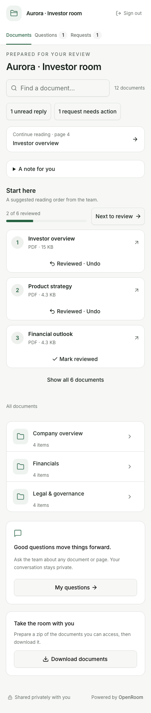
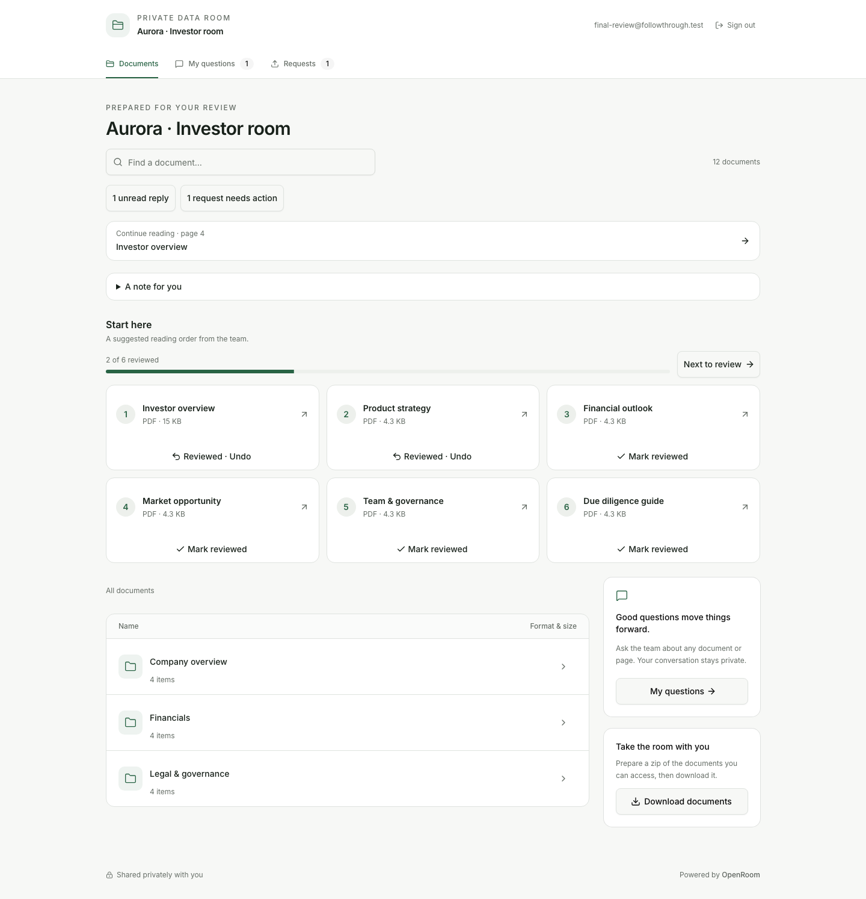
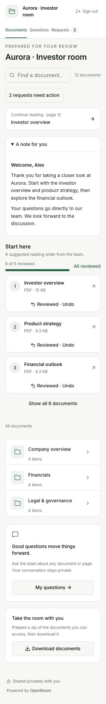
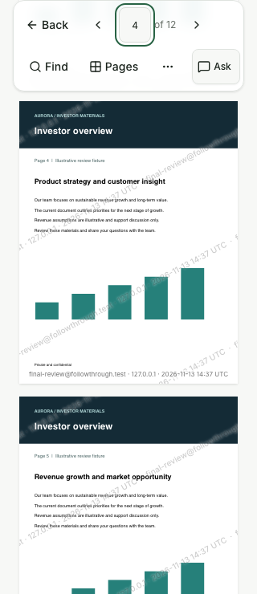
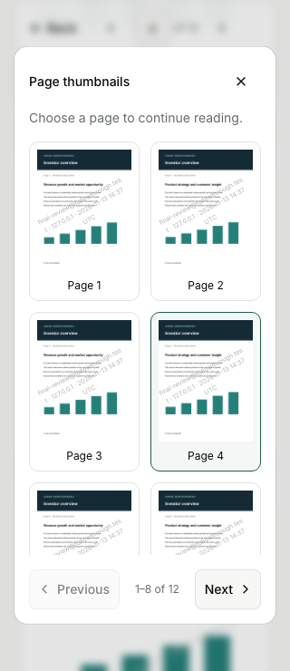
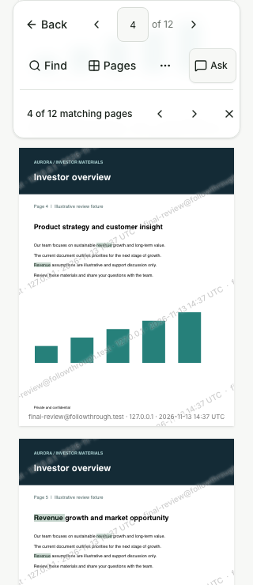
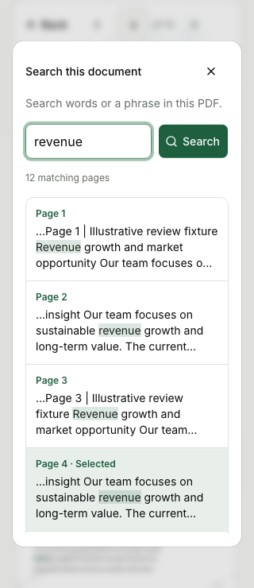
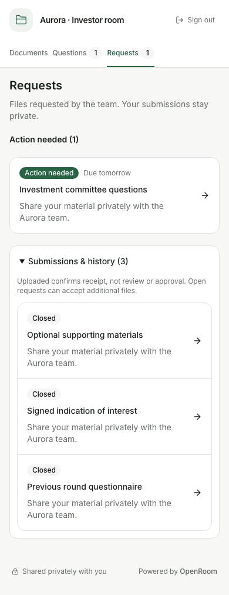
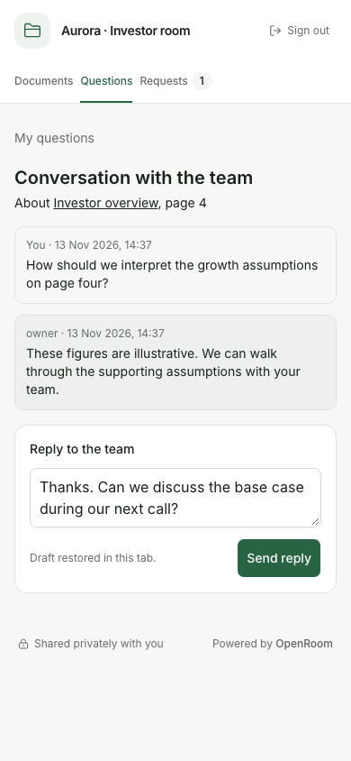

# Investor follow-through — 13 November 2026

Implemented the six changes proposed in the [preceding visual audit](2026-11-13-investor-next-steps.md).
All examples use disposable local fixtures with illustrative material, not company information.

## Delivered

| Area                | Result                                                                                                                                                                                                                                                               |
| ------------------- | -------------------------------------------------------------------------------------------------------------------------------------------------------------------------------------------------------------------------------------------------------------------- |
| Returning home      | One action summary for document changes, unread replies and outstanding requests. Continue reading appears early. Unchanged welcomes collapse on return in the tab; explicit disclosure choices persist until the note changes. First visits hide the change filter. |
| Mobile PDF controls | Two primary control rows at 320 px; zoom in an accessible menu. Thumbnails use a bounded dialog with an independently scrolling grid and always-reachable pagination.                                                                                                |
| PDF search          | A persistent matching-page navigator, current-result counter, selected row, readable emphasized snippets and precise term highlights. Closing the dialog keeps the search; clearing it removes highlights.                                                           |
| Requests            | A dedicated navigation destination and outstanding badge, action-first due-date ordering, local relative deadlines, submitted/closed history and accurate empty-history copy.                                                                                        |
| Conversations       | Exact-page document references, local timestamps with ISO detail, session-scoped reply drafts, explicit sending/failure feedback and mobile-sized controls.                                                                                                          |
| Personal reviews    | Explicit Mark reviewed / Undo on visible pins and in the reader, progress and Next to review. State is version-bound and personal; opening a file never marks it reviewed.                                                                                           |

The new review table is additive. Verified sessions share only that investor's reviews across
currently authorized links. Unverified sessions remain separate, even for the same typed email.
Preview cannot persist reviews. Current permissions, pin membership, NDA and link/session validity
are checked before writes. Stale versions return 409. Reviews are included in data export and erasure.
No new owner action, external service or dependency was introduced.

## Validation

The checks ran against the production build through the actual Node 24 server, real SQLite and disk
storage on a disposable local origin. Owner operations created twelve PDFs, three folders, six pins,
personalized links, private conversations and file requests. PDF fixtures included twelve pages,
searchable text and charts. Request submissions used the real streaming upload and completion paths.
The browser was Chromium at 320, 390, 768 and 1440 px; key screenshots were opened for visual inspection.
Verified boundary fixtures were created with the production session helper; no email-verification
provider was simulated. Application modules and storage were not mocked.

**137 targeted checks passed** (42 main browser checks, 35 access/privacy checks, 37 additional
browser/text checks, 14 migration/rollback checks, 3 Unicode edge cases and 6 final smoke checks).
20 selected screenshots are retained with this record.

Checks covered:

- First and returning visits, explicit welcome choices and changed-note reset; current change filtering.
- Mark, undo, complete, next-unreviewed, no automatic completion and version resets.
- Unknown, unpinned and hidden files; removed pins; changed allow/block rules; verification and NDA
  gates; expired sessions/links; revoked links; member previews; verified and unverified isolation.
- Real review export and erasure, including both identity and session-owned records.
- PDF search, highlighted terms, matching-page navigation, selected rows, clear/no-match states,
  exact-page precedence and clamping, resizing, zoom, bounded thumbnails, keyboard focus trapping,
  Escape, focus restoration and page positioning below the sticky toolbar.
- Unicode ligatures, combining accents, Greek sigma forms and literal markup in search text.
- Request sorting, overdue dates, closed empty history, real upload receipts and movement to history.
- Reply draft reload, single-character persistence, offline failure, successful send and clearing,
  plain-text rendering and sign-out cleanup.
- Real migration from the preceding journal, snapshot creation, old-journal rejection and launcher
  rollback with Litestream. Document bytes, encrypted settings, room metadata and SQLite integrity
  survived; rollback created the new replication CURRENT pointer.

Biome, svelte-check, the no-comments check, production build, CLI help smoke check and whitespace
validation passed. No browser JavaScript errors were observed. Throwaway scripts and disposable data
were removed after verification; no test suite was added to the repository.

The screenshot pass led to fixes for welcome-toggle persistence, mobile navigation spacing, review
button/card grouping and dialog focus restoration. The 320 px PDF toolbar measures **114 px**, down
from **162 px** in the earlier audit. Search adds its own result row only while results exist.
PDF screenshots use the viewport because distant canvas pages are deliberately released; full-page
captures would show blank placeholders outside the rendered area. Final dialog captures wait for
transitions so they show settled UI.

[Individual check results and geometry](ui-follow-through-2026-11-13/results.json).

## Screenshots

### Returning home and review progress

### Reading and search

### Requests and conversations

This was local validation, not a deployment or release runbook execution. Native-device testing,
other browser engines and a full screen-reader audit were not performed. PDF search still depends
on extractable document text; OCR is not included. Reply drafts remain local to the tab, while
verified review progress is server-side. Existing backup-retention exceptions continue to apply.
