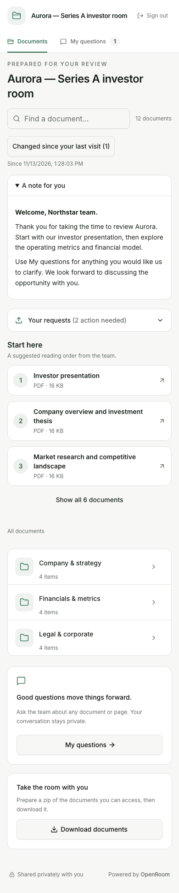
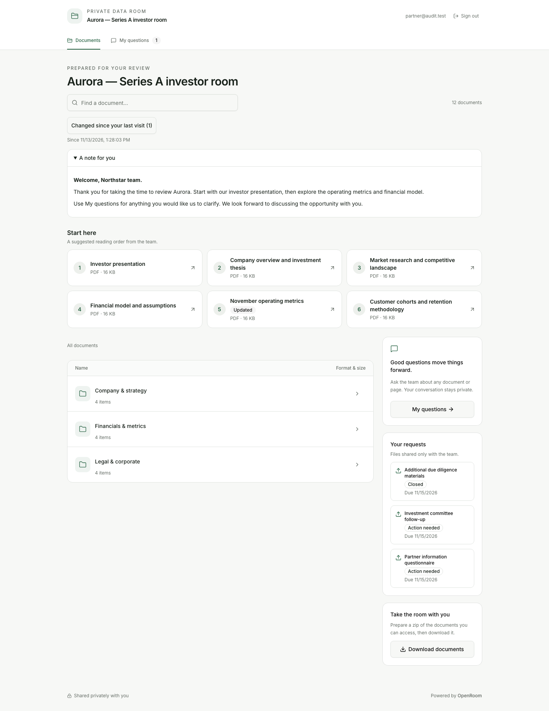
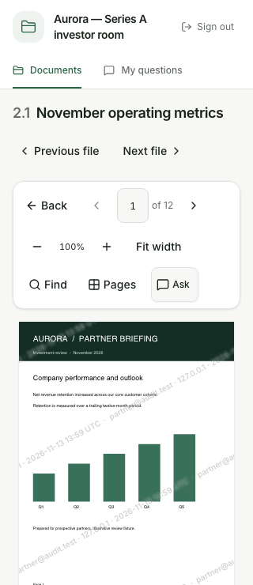
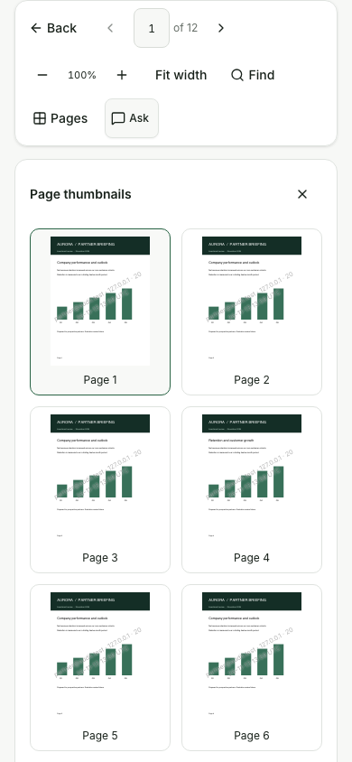
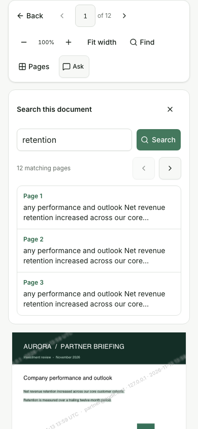
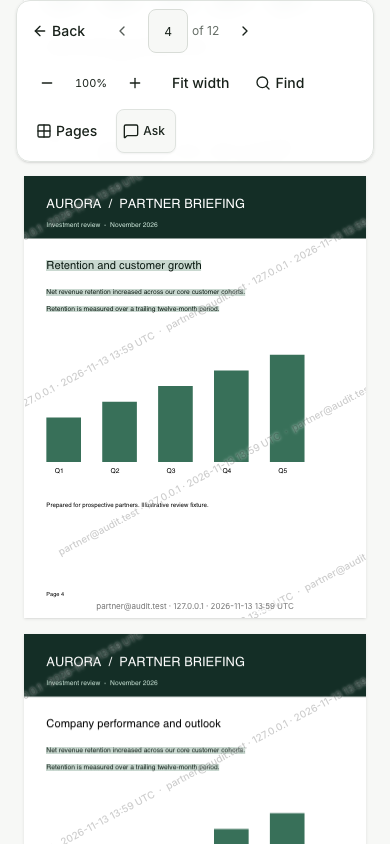
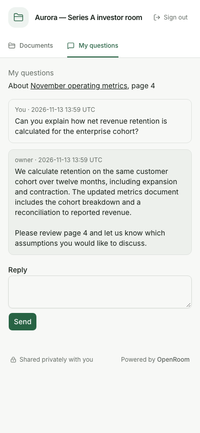
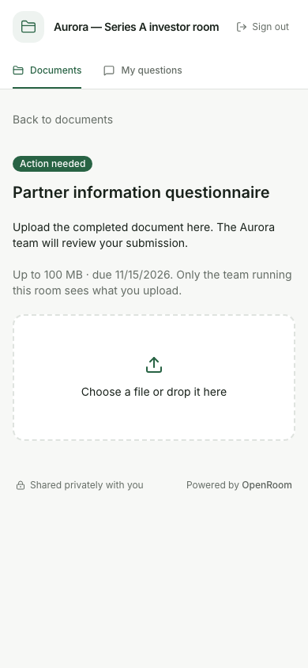
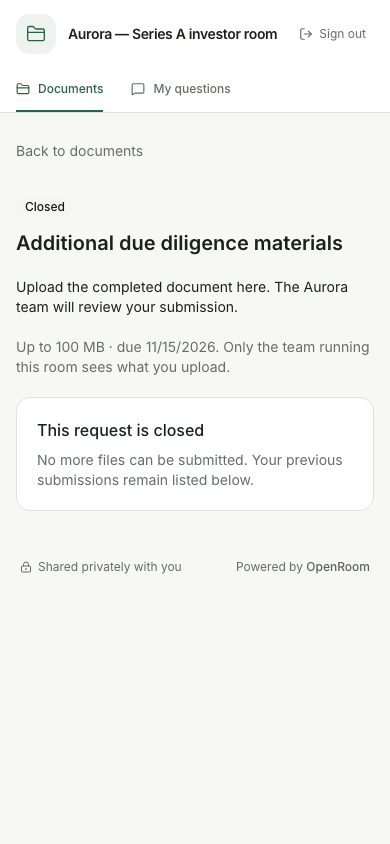

# Investor UI review and next improvements — 13 November 2026

Review only: no application code was changed in this pass.

The current built app was exercised through its real server, SQLite and disk storage on a disposable
local origin. Owner operations created a representative room with twelve documents, three folders,
six pins, a personal welcome, a team reply and three requests, including a closed request. Generated
PDFs contained charts, multiple text matches and twelve pages. The fixture's text and financial
content are illustrative, not company information.

Seventeen fresh screenshots were captured in Chromium and key screens were opened for visual
inspection. Widths were 1440, 390 and 320 pixels. Entry, first visit, returning visit, changed-file
filter, PDF reading, thumbnails, search, questions, conversation and request states were covered.
There were no browser JavaScript errors during this walkthrough. This was a UX audit, not a repeat
of the earlier 98-check regression run or a native-device accessibility audit.

## Findings and recommended order

| Order | Improvement               | Observed evidence                                                                                                                                                                                                                                          | Proposed result                                                                                                                                                                                                                                                                              |
| ----- | ------------------------- | ---------------------------------------------------------------------------------------------------------------------------------------------------------------------------------------------------------------------------------------------------------- | -------------------------------------------------------------------------------------------------------------------------------------------------------------------------------------------------------------------------------------------------------------------------------------------- |
| 1     | Returning-visit home      | On the 390×844 fixture, Start here begins at 735 px and folder navigation at 1129 px. The unchanged welcome is expanded again. Updates, replies and requests are split across several locations.                                                           | A compact actionable summary of changed files, unread replies and open requests; remember the welcome disclosure and collapse a previously seen unchanged note on return. Keep first-visit context, show Continue reading early, and explain or hide the disabled first-visit change filter. |
| 2     | Mobile reader controls    | The PDF toolbar wraps to three rows and measures 162 px at 320×740. The thumbnail panel is 930 px tall at 390 px wide, placing pagination below the viewport.                                                                                              | Keep Back, page position and primary reading controls compact. Put secondary tools in an accessible menu. Show thumbnails in a bounded drawer/sheet with visible close/pagination controls; retain 44 px touch targets and watermarking.                                                     |
| 3     | PDF search continuity     | Selecting a result scrolls the search panel and its Previous/Next controls out of view. Results have no visible selected-row treatment or current-result counter; snippets can begin mid-word. Whole text spans are highlighted rather than only the term. | A compact persistent result navigator near the reader toolbar, current matching-page position, selected result styling, readable snippets with ellipses and emphasized terms, and more precise highlights. Keep matching pages distinct from occurrence counts.                              |
| 4     | Requests ranked by action | A newly closed request appears above two Action needed requests because the list is newest-first. A request page still marks Documents as the active navigation destination. Closed empty history refers to submissions that do not exist.                 | Put open requests first, then due date; move completed/closed requests into a history disclosure. Provide a clear Requests destination with an action count, useful relative due dates, and correct empty-history copy.                                                                      |
| 5     | Conversation usability    | The conversation uses compact raw UTC timestamps and a plain Send button without explicit sending state. Its document reference displays page 4, but the link contains only the file ID, not a page destination. The reply form has no draft persistence.  | Page references open the exact authorized document page. Add local-time timestamps with exact-time detail, a clear conversation heading, session-scoped draft recovery, explicit sending/retry feedback and mobile-size reply controls.                                                      |
| 6     | Personal review checklist | Pins communicate order, but none communicates whether the investor considers a document reviewed. Existing PDF resume tracks a page in this tab; it is not a review checklist.                                                                             | Explicit Mark reviewed / Undo for pinned documents, a small progress summary and a next unreviewed action. Never infer reviewed status merely from opening a file. Scope state to verified identity or unverified session, bind it to the file version, and recheck current access.          |

Start with items 1–4: they improve the existing workflows without adding another major product area.
Items 5–6 then improve follow-through and longer diligence sessions. Any new owner-configurable action
must use the operation registry and generated surfaces; investor state must remain covered by export,
erasure, access checks and documented identity boundaries.

## Screenshot evidence

### Returning home

### Reader and search

### Conversation and requests

[Measured geometry and browser errors](ui-investor-audit-2026-11-13/measurements.json).

The entry gate, typography, card styling and core responsive layout are consistent. The proposed
changes focus on information priority, reducing vertical space, and retaining context while reading.
Measurements are specific to the supplied fixture and viewport, not universal page-height claims.
