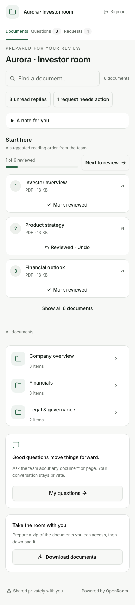
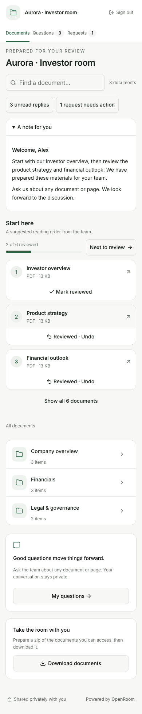
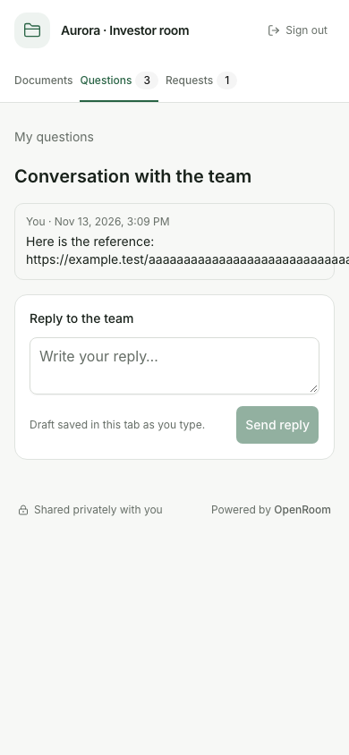
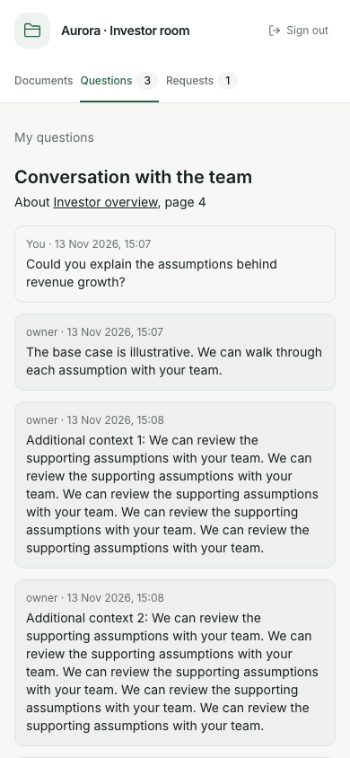
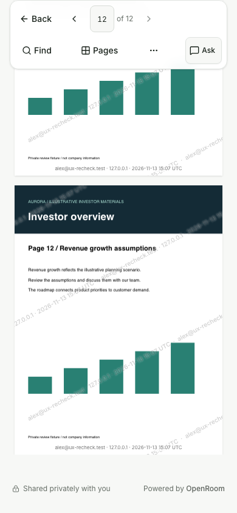
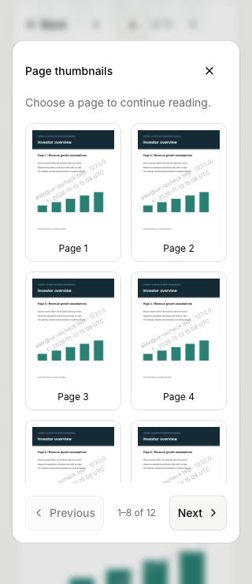
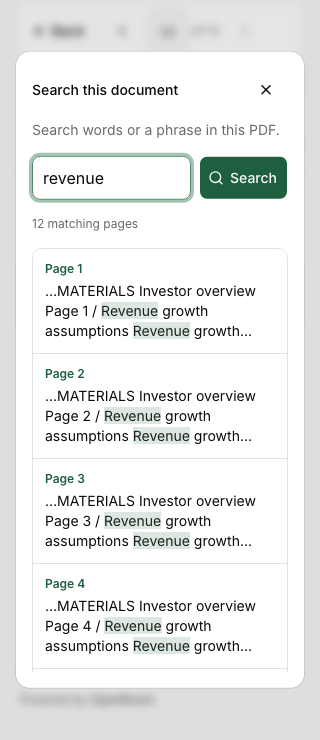
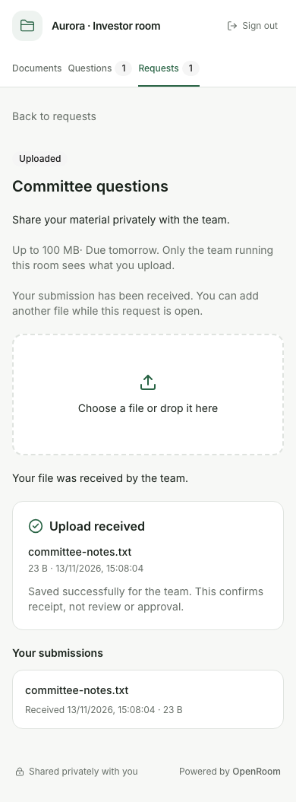

# Investor UX recheck — 13 November 2026

Reviewed all six recently implemented areas again, including entry, document completion, repeated PDF
tool use, uploads and longer conversations. This pass changes no application code. It proposes the
next work from reproduced behavior and fresh visual evidence.

The current production build was checked against source timestamps and run locally through the real
Node 24 server with a disposable SQLite database and disk storage. Owner operations created eight
PDFs, three folders, six pins, a personalized link, requests and replies. The PDFs have twelve pages.
All content is illustrative. Twenty-four fresh Chromium screenshots were captured at 320, 390 and
1440 px; sixteen key screenshots were opened for visual inspection. There were no JavaScript errors.
The walkthrough included actual investor entry, review/undo controls, PDF search/navigation, a real
request upload, reply draft recovery and a document-version update. This is a UX review, not a rerun
of the preceding 137-check access, migration and regression validation.

## Recommended next changes, in priority order

| Priority | Area                          | Observed evidence                                                                                                                                                                                                                                                          | Recommended change                                                                                                                                                                                                                                                                                                                    |
| -------- | ----------------------------- | -------------------------------------------------------------------------------------------------------------------------------------------------------------------------------------------------------------------------------------------------------------------------- | ------------------------------------------------------------------------------------------------------------------------------------------------------------------------------------------------------------------------------------------------------------------------------------------------------------------------------------- |
| 1        | Returning home                | A welcome that was collapsed after reload reopened immediately after Mark reviewed completed. The fresh reproduction measured `open=false` before the action and `open=true` afterward. Separately, folder navigation starts at 1,017 px on the returning 390×844 fixture. | Fix disclosure state across data refreshes. Then make the returning Start here section compact, with remaining documents emphasized, an explicit Show reviewed disclosure, and an accessible jump to All documents. Preserve the team's ordered guide.                                                                                |
| 2        | Conversations                 | A single long URL expanded the conversation document to 1,895 px at a 390 px viewport. In an eight-message thread, the latest message started at 1,501 px and the draft at 1,783 px, with no jump action.                                                                  | Wrap long text and URLs consistently. Add Jump to unread, Latest reply and Resume draft navigation, with an unread divider and a compact reply shortcut. Preserve deliberate reading/scroll position; do not automatically jump past unread messages. Clamp long question previews in the list while keeping full text in the thread. |
| 3        | Finishing a document          | On page 12, Mark reviewed and Next in Start here were both roughly 4,900 px above the viewport. The persistent toolbar offers page navigation and Ask but no document-completion action.                                                                                   | Add an end-of-document completion area: Mark reviewed, Next in Start here and Back to documents. Keep Undo and the explicit nature of review state. A compact reachable action can supplement the bottom area without adding a permanent large mobile toolbar row.                                                                    |
| 4        | PDF search and thumbnails     | Opening Pages on page 8 displayed pages 1–4 while the selected page 8 thumbnail was below the grid's visible area. Selecting search result 12 and reopening Find showed results 1–4; the selected row began at 1,404 px outside the scroll region.                         | Scroll the current thumbnail and selected search result into view on open. Retain each panel's scroll position and show current-result context inside the dialog. Preserve focus behavior, keyboard navigation and visible pagination.                                                                                                |
| 5        | Review checklist and versions | Replacing a reviewed document during the first visit changed progress from 2 of 6 to 1 of 6. The document simply returned to Mark reviewed, with no Updated badge or explanation because the visit has no comparison baseline.                                             | Explain this independently of visit-change badges: New version — review again, current version/date, and an optional Previously reviewed version label. Keep version-bound state; never carry completion forward automatically. Existing conversation page links should also make clear that they open the current document.          |
| 6        | Request completion            | After upload, the 160 px upload drop zone still precedes the receipt; the receipt begins at 659 px. On returning to Requests, the just-submitted item is hidden with closed items inside Submissions & history.                                                            | Lead with a compact confirmation and filename. Change the primary drop zone into a secondary Add another file action after success, with Back to requests nearby. Show a recent-submission summary or open the relevant history item when returning, while keeping outstanding requests first.                                        |

The first two rows include reproduced UI bugs. The other rows improve the completion and return
journeys that are already working. Implement these as focused improvements to the existing screens;
a new dashboard or major navigation redesign is unnecessary for this pass.

## Implementation and acceptance notes

- Welcome: the component sets the disclosure's initial `open` attribute from note length and changes
  the DOM during mount. Keep disclosure state consistent through review saves, focus refreshes and
  unread-count refreshes. Test first visit, explicit open/close, unchanged return and changed content.
- Conversation: apply safe wrapping to both investor and member text without rendering it as HTML.
  Ensure the page remains within 320 and 390 px with long URLs and unbroken strings. Restore drafts
  and make them reachable in long threads without changing privacy boundaries.
- Reader completion: keep review confirmation explicit and version-checked. Do not show unavailable
  or unpinned files as next steps, and keep room/folder/search return context intact.
- PDF panels: retain internal scroll independently of document scroll. Focus restoration must not
  jump the document away from the chosen page. Test late results, page 8, resize, Escape and keyboard
  navigation, not only the first four visible results.
- Version feedback: derive the explanation only from the investor's own prior review and currently
  authorized file metadata. An unverified session must not learn another session's review history.
- Requests: retain the distinction between receipt and team approval. Additional uploads remain
  available while open, and closure/access changes continue to be enforced by the existing endpoints.

## Evidence

### Home: collapsed note reopens after review

### Conversation: long text and long threads

### Reader and PDF panels

### Versions and submissions

[Measured geometry and browser errors](ui-investor-recheck-2026-11-13/observations.json).

Entry, basic request ordering, short conversation layout, local timestamps, recovered drafts and the
compact PDF toolbar remained readable in the reviewed fixtures. The observations above are specific
to the stated fixtures and viewport sizes. No native-device, other-engine or screen-reader audit was
performed. The disposable server, scripts, credentials and data were removed after capturing evidence.
