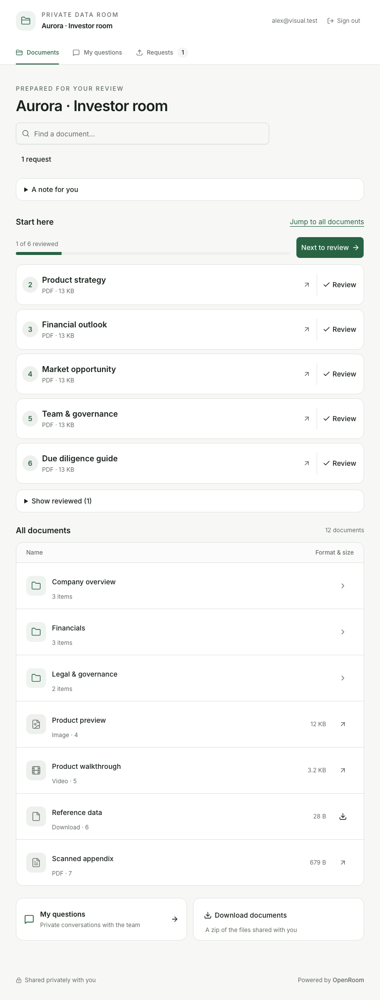
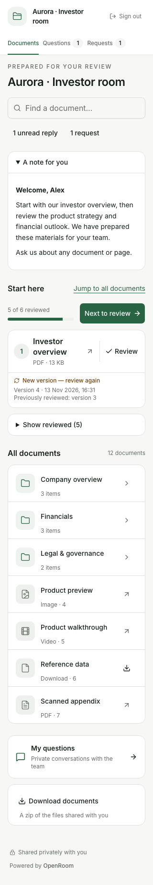
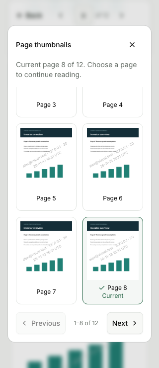
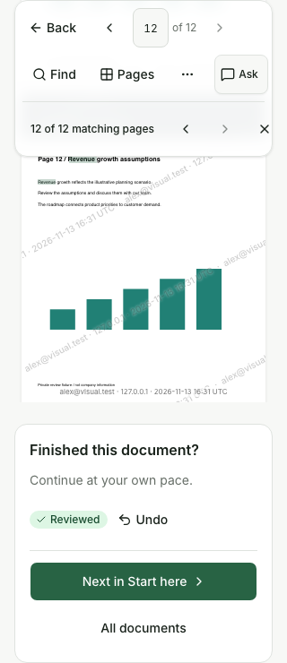
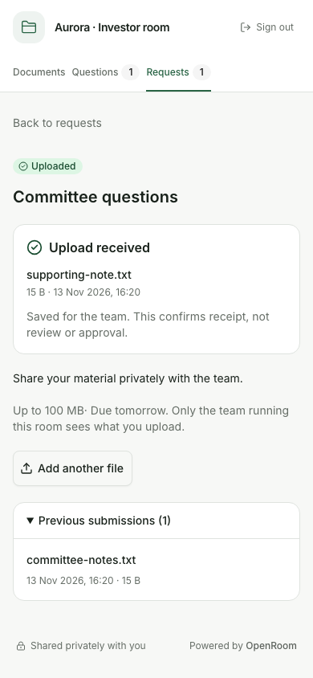
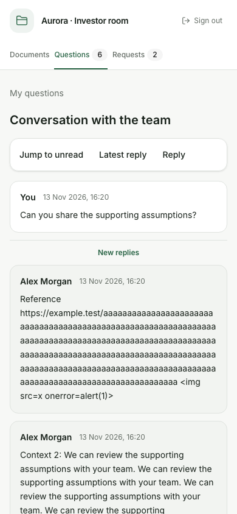

# Investor visual refinement — 13 November 2026

Implemented the eight recommendations from the screenshot-only investor UI review.

## Changes

1. Start here uses compact, aligned rows through tablet widths. Questions and download utilities sit
   side by side on tablets, with a desktop sidebar and a phone stack.
2. Document titles have stronger weight and size. Review is a quieter, separate action; Reviewed is
   a status badge with a distinct Undo action.
3. Phone search fills the available width. Changed documents, unread replies and requests use shorter
   labels while retaining comfortable touch targets and full accessible descriptions where needed.
4. All documents has a proper section heading and count. Folder and global-search headings reflect
   the current view; compact Questions and Download documents utilities reduce repeated decoration.
5. Action needed, Uploaded and Closed have semantic icons and amber, green and neutral styles that
   remain independent of the room's brand color. Color is never the only status cue.
6. Request receipts show the latest upload once. Previous submissions expand separately with the
   same date formatting. Closed requests use a compact notice and one return link.
7. Conversation sender names are prominent, timestamps quieter, and New replies divides messages
   outside the message cards. Long content wraps and narrow-phone shortcuts remain on one row.
8. PDF thumbnails explicitly mark Current with a check. Amber search matches differ from selected
   rows. Completion emphasizes the next-document action and separates it from review status/Undo.

Visual inspection also found and corrected a tablet flex-layout override, cramped version metadata
at 320 px, a folder breadcrumb shown during global search, a wrapping thumbnail check, undersized NDA
renewal controls, and missing whitespace in a closed-request sentence. Final captures show the fixes.
PDF completion captures wait for rendering and scroll to the panel end so both navigation actions
can be inspected; an earlier cropped capture was a capture-timing issue rather than a layout defect.

No new dependencies, owner operations, schema changes, access rules or review-persistence rules were
introduced. User documentation, contributor notes, the agent runbook, skill and llms.txt were updated.

## Validation and scope

The production build ran on Node 24 through the real server with disposable SQLite and disk storage.
Fixtures included twelve-page PDFs, six pins, folders, replacement versions, image/video/download-only
files, a PDF without text, private conversations, requests and submissions. Email verification used
an actual loopback SMTP receiver; no external email was sent. No application modules were mocked. Test-harness retries corrected SMTP quoted-printable decoding,
waiting for client hydration, an inline-text width assertion and expanded-editor capture selection;
only completed passing runs are retained.

The six retained result files record **163 passing assertions**, with **79 fresh screenshots** all
inspected with vision. `npm run lint` passed (Biome, svelte-check with zero errors and warnings, and
the no-comments check); `npm run build` passed.

The browser assertions cover review/undo and focus, welcome persistence, folder
and search navigation, version resets, current thumbnails, late search results, Escape focus,
completion/next navigation, all reader types, private questions and draft retry/recovery, unread
boundaries, upload/history/closure, ZIP failure/retry and a real ZIP download. They also cover custom
brand status separation, hidden-file denial, isolated unverified receipts/conversations, owner preview,
password/custom-field/NDA entry and renewal, actual email-code verification, and empty/error screens.

The screenshot manifest lists every retained image. Each was opened and inspected with vision,
including entry screens, first/return/completed home, search/folders, readers and PDF dialogs,
questions/conversations, requests and receipts, empty/error states, and owner appearance, pinning,
personal welcome and sharing previews. Main responsive surfaces were checked at 320, 390, 768 and
1440 px; the manifest records actual image dimensions. Some long screens use full-page captures,
while dialogs and reading positions use viewport or element captures.

This is broad validation of the investor journey and the related personalization screens, not a
claim that every administrative route or every possible state has been exhaustively tested. Chromium
was used; native devices, other engines, a screen-reader audit and the clean-server release runbook
were not covered. No production deployment was performed. Disposable scripts, credentials, mail,
server and data were removed after preserving non-sensitive evidence.

## Evidence

See the [screenshot manifest](ui-visual-refinement-2026-11-13/screenshots.md) for the full gallery and
[validation summary](ui-visual-refinement-2026-11-13/validation.json) for check counts and outcomes.

