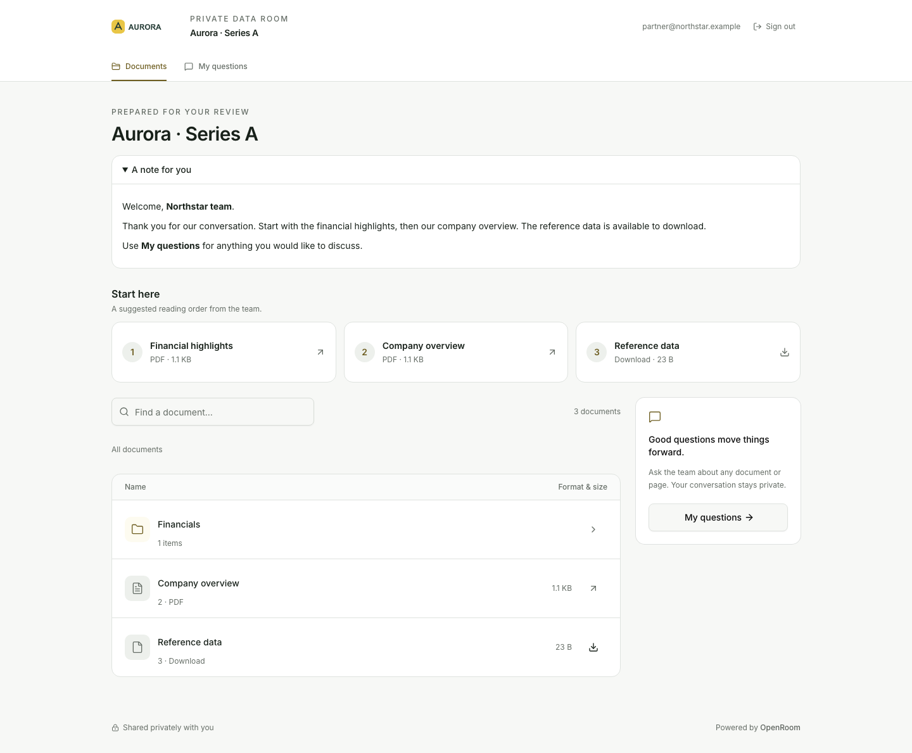
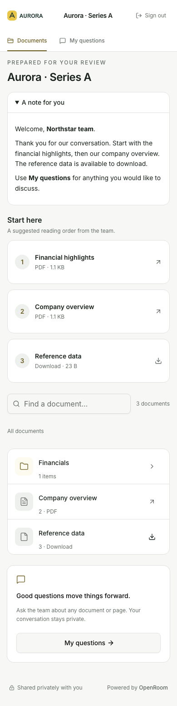
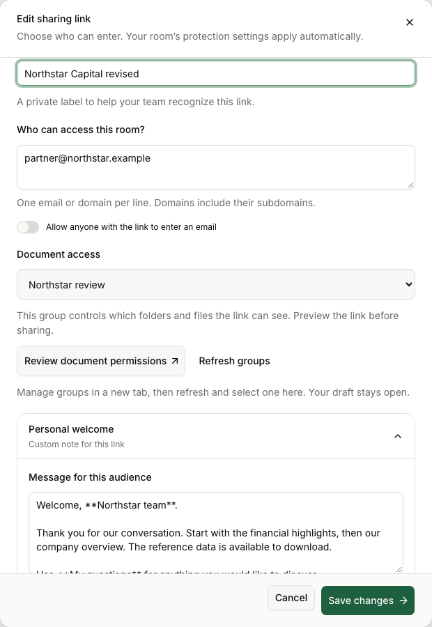
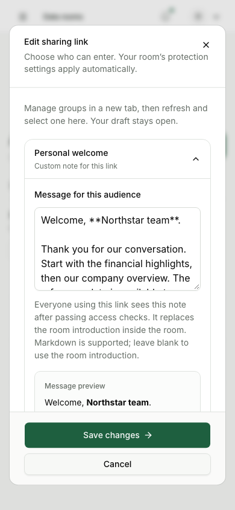
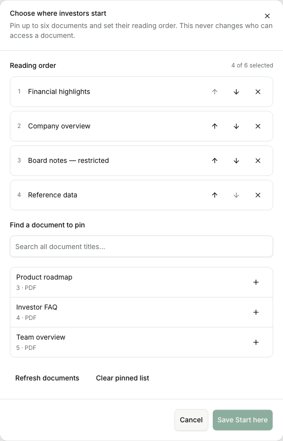
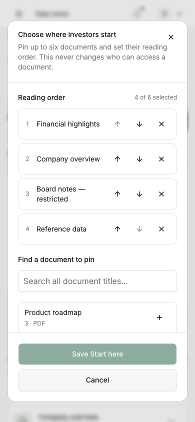

# Personal welcomes and Start here verification

Date: 2026-11-13. Local implementation and verification; no production deployment or publication.

## Delivered behavior

Sharing links have an optional Markdown welcome, edited and previewed in the sharing dialog.
Everyone using a link sees its note after all access checks. It replaces the room introduction
inside the room; blank/null restores that introduction, and omitted updates preserve the note.
The entry screen continues to use the general room introduction. The limit is 4,000 characters.

Room Documents includes a Start here editor for up to six documents, with search, reading-order
controls, Save/Cancel, clear and refresh actions. Investors receive only permitted pins. No visible
pins means no section; hidden entries leave no numbering gaps. Pins do not change access. Renames,
moves and new versions preserve identity; deletion removes the pin; duplication maps the order to
new files and does not copy sharing links or personal notes.

Both features use registered operations with current-role enforcement and audit records, available
through the admin UI, REST, MCP, OpenAPI and generated CLI. No dependencies were added.

## Verification

116 throwaway checks passed against real SQLite files and local disk storage:

- 57 browser and application checks: create/edit/cancel, ordered save, six-file limit, duplicate
  and cross-room rejection without partial writes, Markdown sanitization, note length, fallback,
  omitted updates, independent link messages, member preview and investor entry. Hidden titles and
  IDs were absent from returned investor HTML/data. Live permission removal blocked the file bytes
  and removed its pin. PDF rendering and an actual download-only browser download succeeded.
  Offline saves retained drafts. Deleting a selected document rejected stale saves; refresh removed
  it explicitly. Deletion cascades and room duplication were verified.
- 24 additional browser/API checks: both features through REST, generated CLI and MCP; OpenAPI
  presence; password, email, real SMTP verification-code and NDA gates; changed NDA, expiry and
  revocation; editor reset/cancel/offline handling; mobile dialog bounds and publishing an empty list.
- 15 role/data checks: observer denial, admin allowance, current-role recheck after demotion,
  frozen-room denial, creation/update audit without personal-note text, pin audit through REST/MCP,
  rename/version identity, folder-deletion cascade and SQLite integrity/foreign-key checks.
- 20 migration/rollback checks: apply the additive migration to a real previous-schema database,
  snapshot creation, legacy defaults, existing encrypted settings and link-token decryption,
  existing disk document bytes, new writes, older-journal refusal, launcher rollback plan and actual
  snapshot swap. The restored database matched the previous journal; secrets and documents remained
  readable, the replaced newer database retained its changes, CURRENT advanced, and the marker cleared.

The rollback drill used the current launcher with the previous migration journal and real Litestream
0.5.17 from the cached image through an isolated Docker wrapper. It did not run a previously released
application binary or a fresh VPS installation. SMTP used a disposable local capture service; no
external invitations were sent. Temporary scripts, databases and credentials were kept outside the
repository and removed after verification; no tests were added to the repository.

`npm run lint` passed (Biome, svelte-check with zero errors/warnings, and no-comments check).
The production build and generated CLI freshness check passed. No browser page errors were observed
in the two browser runs. Responsive checks covered 320, 390, 768 and 1440-pixel widths.

## Visual review

The screenshots below are unretouched Chromium captures of the locally built application using
fictional Aurora/Northstar fixtures. Desktop investor captures use a 1440-pixel viewport; phone
captures use 390 × 844. Investor captures include the full page; desktop editor captures are cropped
by Playwright to the actual dialog. The assistant opened and visually inspected all six final images.

The investor note and reading cards have readable spacing, wrapping and clear document actions.
Phone cards form a single column. Both editors keep their header and save/cancel controls visible
while the body scrolls. The restricted board document is visible in the member editor but absent
from the investor view; three permitted cards are numbered consecutively. The disabled Save control
in the pin captures indicates an unchanged draft.

