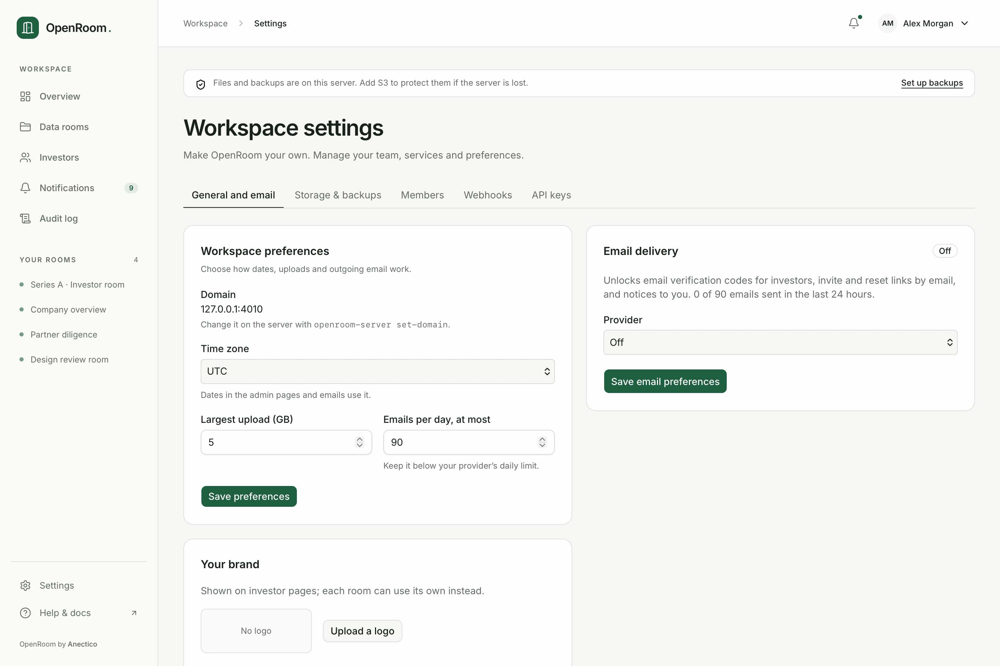
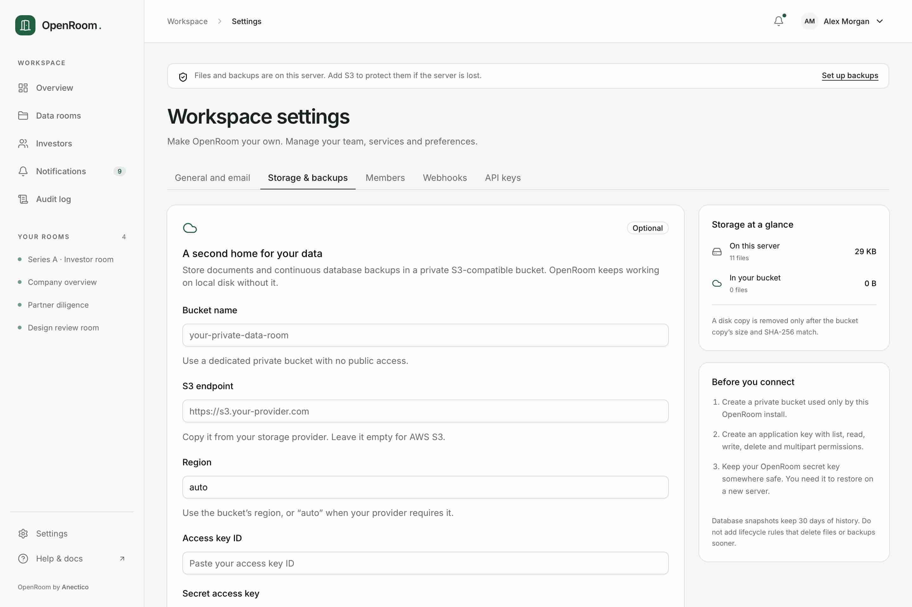
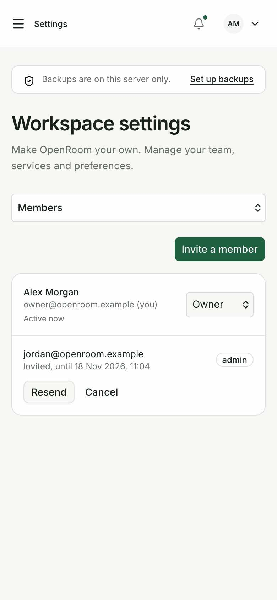
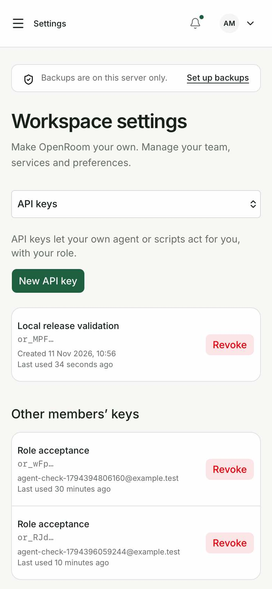
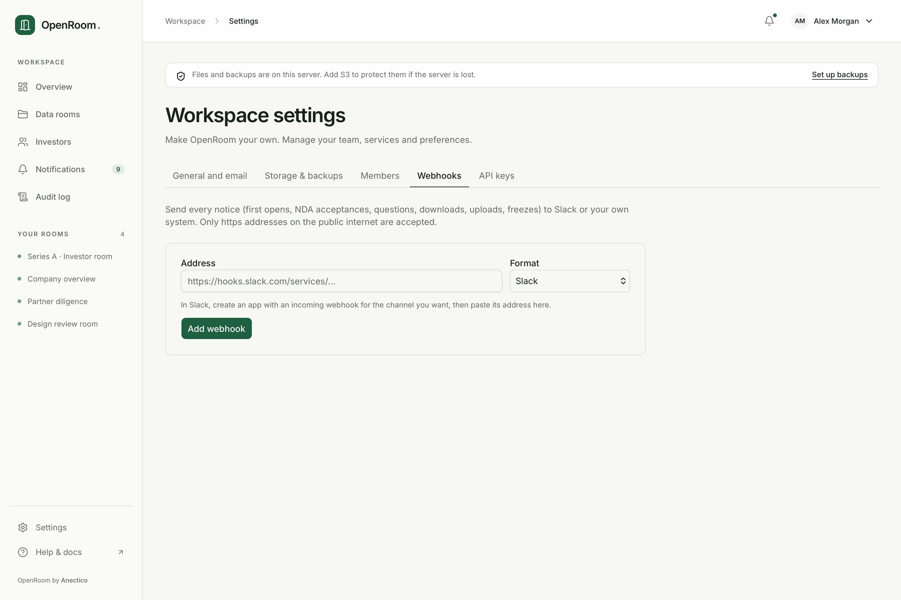

# Workspace settings

Owners manage workspace preferences and services in Settings. Admins manage rooms, documents,
links, questions and investor activity. Observers read; they do not change those resources. Members
can manage their own account and API keys. On a phone, choose a settings section from the selector.

## General, branding and email

Choose the time zone used by admin dates and emails, the maximum upload size and the daily email
cap. The domain is managed on the host with `openroom-server set-domain DOMAIN`; the change updates
both Caddy and the app's public origin. Limits apply to new operations after saving.

**Workspace appearance** provides a logo, brand colour and footer-credit setting, with live
Documents/Entry previews with Fit to panel, 360 px Phone and 1280 px Desktop widths. Fixed-width samples show their scale and can be viewed at actual size inside the scrollable frame. Choose a PNG, JPEG or WebP logo under 700 KB;
OpenRoom re-encodes it to a PNG at most 512 pixels wide/high. SVG is refused. The logo also supplies
a 64-pixel browser icon on investor pages; admin pages retain the OpenRoom icon.

Changes stay in a draft until **Save appearance**. **Cancel changes** restores the saved values.
Button text switches between black and white to suit your colour; navigation and focus indicators
use a darker, readable variation. White labeling hides the investor footer credit; the admin keeps
“OpenRoom by Anectico”.

In **Room settings & branding**, edit the room name and welcome Markdown alongside its logo and
colour. The editor shows which values come from the workspace. **Use workspace logo/colour** stages
a reset; save to apply it. Later workspace changes flow through to rooms without overrides.
At email entry, the welcome is available below the form through **Read the welcome**, so long introductions never push access controls down the page. Inside the room it appears as a collapsible introduction, including
returning visits. Introductions start with a two-line excerpt and **Read full welcome**, keeping documents
within reach. An investor’s explicit open/closed choice is remembered for that note in the same tab. Empty introductions use a brief default explanation.

On phones and tablets, switch between **Edit** and **Preview** while retaining your draft; the save
bar stays available. Desktop shows both together. The preview scrolls within a bounded frame and
uses the investor navigation, Start here cards and document rows, including inherited brand colour.

Appearance keyboard focus scrolls clear of the save bar. Invalid brand colours show an inline message and return focus to the colour input; the footer error also links back to that field. Sample preview dimensions describe the rendered sample canvas, not the device running the admin app. Use **Actual size** for readable detail when a desktop sample is scaled down on a phone.

The previews show sample Documents, Questions, Requests and the email-entry screen; password, verification and NDA
requirements still follow each sharing link's access settings. Use the link's investor preview
to review its actual document permissions.

Email is optional. Choose Resend or SMTP, enter the sender and credentials, save, then send a test.
Leave a saved secret empty to keep it; it is never shown again. Server environment overrides are
read-only in the UI. The [email guide](email.md) explains sender verification, Gmail app passwords,
daily limits and delivery errors. Turn investor verification on only after a successful test.

## Storage and backups

Connect a private S3-compatible bucket or keep local disk. The page shows disk/bucket usage,
confirmed replication, copy progress, failures and retry. To change destinations, choose **Move
storage**, review the effect and confirm. Uploads pause while retained files and frozen archives are
copied and verified. Read [storage and recovery](storage-and-backups.md) before moving: keep the old
bucket for at least 30 days and keep the secret key off the server.

## Members

Invite a member and choose owner, admin or observer. Without email, copy the one-time password-setup
link and send it through your usual channel. The link expires after seven days. Pending invites can
be replaced or canceled. Changing a member's role changes their API-key permissions on the next
request. Removal ends their access. The last active owner cannot be removed or demoted.

## API keys

Create a named key for an agent or script. Copy it immediately and store it securely; it is shown
once. The result includes the REST and MCP addresses. A key acts as its member with the current
role. Revoke unused keys; owners can revoke another member's keys too. Prefer a dedicated key for
each automation. See [CLI and MCP](cli.md) for connection and upload details.

## Webhooks

Webhooks are optional and send notices to a public HTTPS endpoint as Slack messages or signed JSON.
For JSON, copy the signing secret once and verify `X-OpenRoom-Timestamp` and
`X-OpenRoom-Signature` against the original body. Keep a bounded timestamp tolerance and reject
replays in your receiver. The signature is HMAC-SHA256 of `timestamp.body`.

Send a test, inspect its delivery status, turn the endpoint off or delete it. Private addresses are
refused during both setup and connection; redirects are not followed. Generic webhook configuration
and secrets are visible only to owners. See [webhook behavior](contributing/branding-and-privacy.md).

## Account, notices and audit

The account menu opens your profile and password settings. Notifications let each member choose
which events send email and mark notices read. The audit log records member, key and operation,
with filters and CSV export. These records cannot be rewritten through the application.
