# Use OpenRoom

OpenRoom lets your team share documents through personal investor links and understand how the
materials were read. The [install guide](agents/install.md) gets the first owner signed in. Email,
S3 and webhooks are optional; a new install works on its own server's disk.

## Your workspace

The overview shows rooms, recent activity and setup items. The sidebar takes you to all investors,
notifications and the audit log. On a phone, open the menu in the header. The backup notice stays
visible until files and confirmed database replication are protected off the server.
The current-viewers panel refreshes every 15 seconds while Overview is visible, shows its last update,
and keeps the last known activity with an updates-paused message if the connection fails. Use its
refresh button to check immediately; returning to the tab or reconnecting also refreshes it.

On a phone, the overview keeps a compact summary above the room list. Room pages keep Share,
the section selector and Settings within reach, with document actions sized for touch.

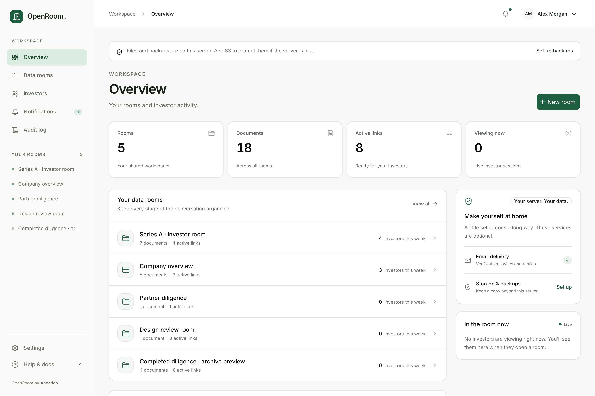

## Rooms, folders and files

Create a room from **Data rooms → New room**. Use **Upload files**, upload a folder from Document
options, or drop files and folders into the document list. Open folders to browse them and use search to find a
title anywhere in the room. Dropped folders retain their hierarchy and empty subfolders, including
when a folder contains more than 100 entries. Hidden files and folders are skipped. **Import from a URL** copies a
direct public HTTPS file; private networks and redirects are refused.

The upload tray stays available when you move between workspace pages. Minimize it to keep working;
expand it to see file names, destinations and failures. Completed batches collapse to a receipt that
can be dismissed. **Retry failed** sends the failed files again; clearing the receipt keeps uploaded
documents. A lost connection keeps the retry controls on screen.

Each row's menu can rename, move, reorder, delete or upload a new version. **Versions** lets you make
an earlier version current. Deletion first explains its effect and asks you to confirm. The original
file type is detected from its bytes. PDFs, images and browser-supported video have an inline viewer;
other types are download-only. See [viewer behavior](contributing/viewer.md) for the limits.

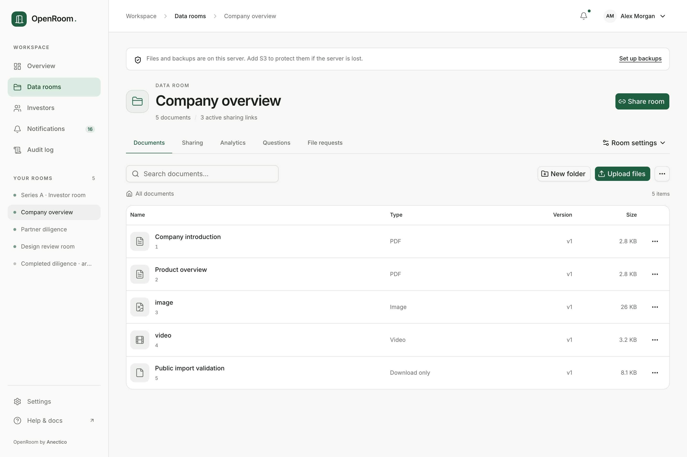

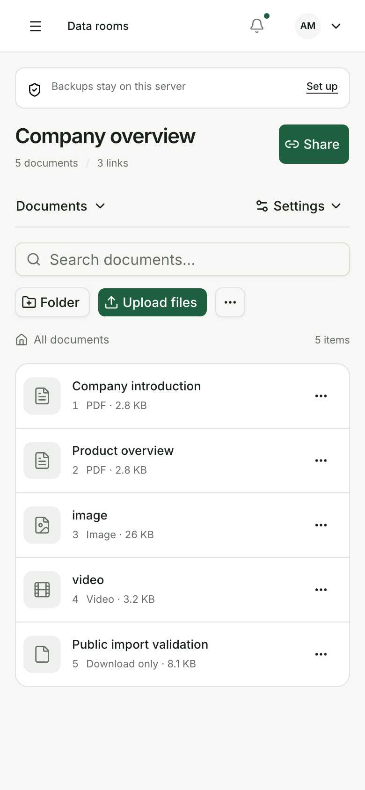

Export an index as PDF or CSV from Document options. Download whole-room zips from there too; the
status shows while the archive is being prepared. Large exports need free space on the server even
when documents live in S3.

## Share with the right people

Open a room and choose **Share room** (or **Share** on a phone). Give it a label and choose approved email addresses or domains, or make
it open. Each link has its own URL, optional password and expiry. Copy its URL directly from the
list. After creating a link, review its audience, document group, protection, downloads and expiry
in the completion dialog. **Copy link** and **Preview as investor** are available immediately.
**Email invitation** appears when email is configured and the allow list contains individual email
addresses; clicking it queues invitations and reports any skipped addresses. Domain entries are not
emailed. Creating the link alone never sends an invitation.

Links inherit **Room settings → Default link protection** unless they override a field. Choose email
verification, NDA, watermarks, download mode, custom questions, read threshold and view notices.
Without verification, an email is a claimed identity. A link that requires verification refuses
entry if email delivery is unavailable. Changing a password ends existing investor sessions;
revocation, allow/block rules, verification and expiry are checked on subsequent requests.

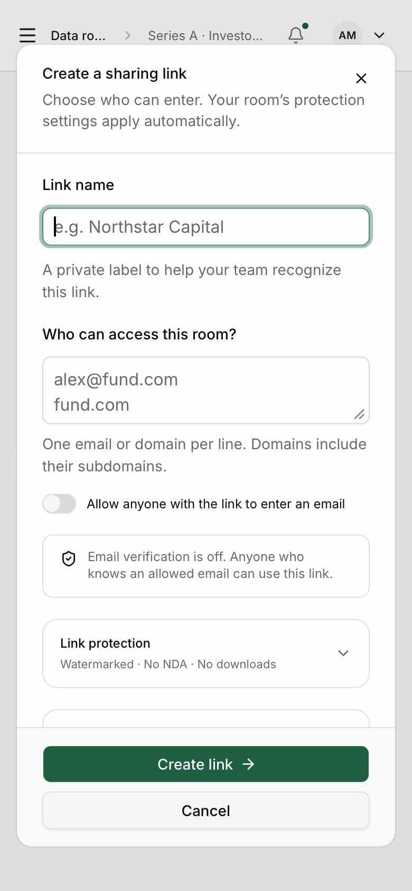

Use **Room settings → Investor groups & permissions** to limit an audience to selected folders or
files. A group has a default access choice; folders pass their choice to descendants unless a child
overrides it. New items inherit those choices. Attach the group in the link editor. A link with no
group sees the whole room, including future documents. **Document access** is always visible in
the link editor. **Choose specific documents** opens group management in another tab, preserving
your draft; return, use **Refresh groups**, and select the intended group. Download-only files remain
downloadable even with **No downloads**; hide them with a group when necessary. Use **Preview group** beside an active link on the group page, or preview
the link from Sharing, before sending it. A group needs an active sharing link to preview its
permissions together with the link's protection settings.

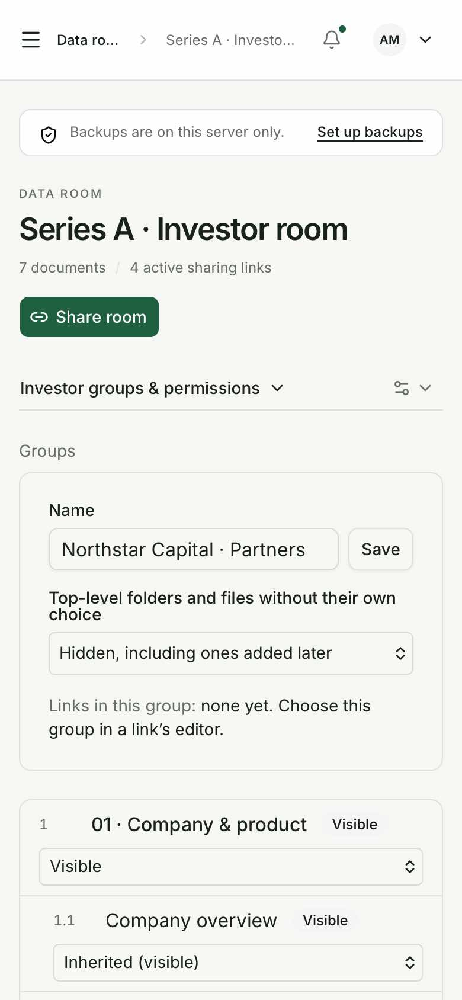

## NDA and the investor experience

Publish your approved agreement under **Room settings → Non-disclosure agreement**, then enable the
NDA requirement in defaults or a link. Publishing a replacement requires affected investors to
accept the new version. Acceptance records retain the version, signed name, email, verification
state, time and IP according to the documented privacy rules.

Investors follow their link, pass the configured gates and enter the document list. On a phone,
a compact header brings the documents higher on the page. **Requested from you** appears above
the list as an expandable section when there are file requests. Search sits directly below the room
heading. On phones, Start here initially shows three compact cards; **Show all** reveals the rest.
Search results show the matching count, two-line titles and the containing folder. Opening a document
and using its return link restores the folder, search and scroll position. A document opened from
Start here follows that reading order with Previous/Next controls, respecting current permissions.

**Continue reading** returns to the last PDF page saved in this browser tab. Reopening that PDF also
restores its page; a new document version starts at page one. Progress is scoped to the current
investor session and is not shared with another investor or synchronized across devices. Browsers
that block tab storage still support normal reading. **Fit width** resets PDF zoom.

Document and PDF navigation controls
have larger touch targets. The PDF viewer
supports paging, zoom, fit and page jumps. Its watermark shows the investor identity. Screenshot
protection is best effort; a browser cannot prevent someone photographing a screen. Downloads obey
the link's current mode: no downloads, individual files or one zip of allowed files. ZIP preparation
shows progress and then a **Download zip** action. A connection failure shows **Retry download**;
retrying an interrupted status check continues the existing job. Leaving the page stops its polling.

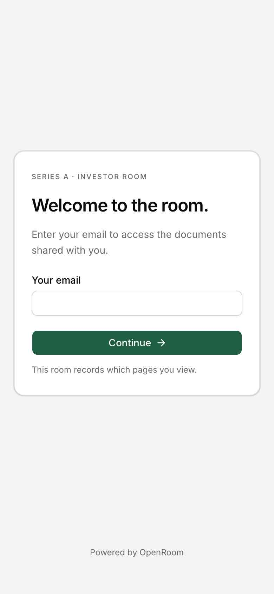

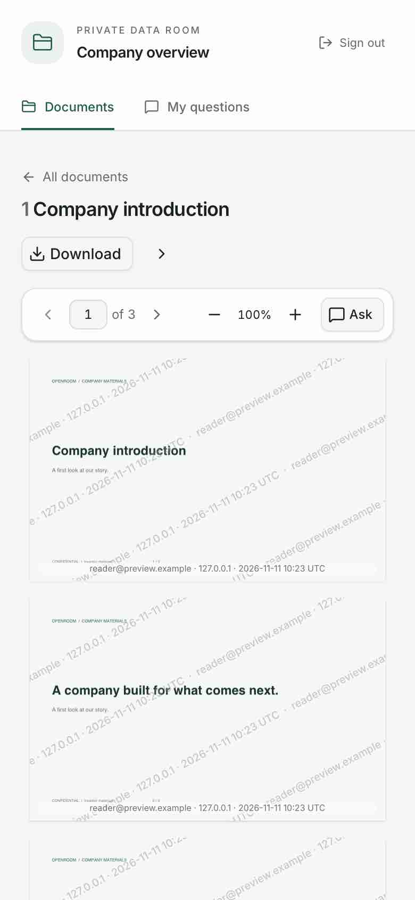

## Activity and investors

**Analytics** shows investors, firms, file/page reading, video coverage and the activity timeline.
Filter by time, link or group; export CSV when needed. Reading time estimates active foreground
viewing, not a guarantee that someone understood a page. Unverified viewers remain labeled.
The workspace Investors page combines activity across rooms and opens an individual history.
Under **Files read**, select **Reading details** to see each version, time on each page and the
video segments watched across that investor's visits. Older versions remain separate from the
current document. Deleting a file removes that file's reading activity along with its live versions.

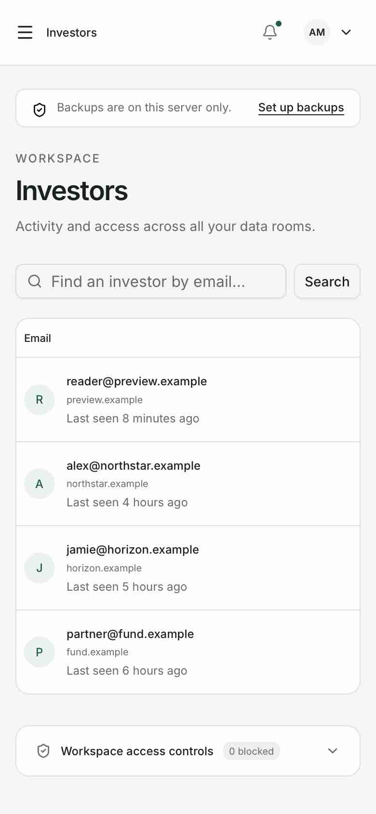

## Questions, answers and FAQ

Investors can use **My questions → Ask the team** to ask about the room or select a document.
They can also ask from a document page. Conversations show **Awaiting answer** after the investor's
latest message and **Replied** after the team's latest response; these are reply states, not read
receipts. Connection failures keep the question draft available for retry. Document choices include
only files the current link permits. Investors return to the conversation under My questions. Members reply
from the room's **Questions** tab. Verified investors can return across their verified sessions;
unverified conversations stay with the original session. Email replies are optional.

FAQ entries appear to every investor in the room. Use them for approved general answers, rather
than copying a private answer into the FAQ without considering its audience. Investor text is
always shown as plain text. Owner Markdown permits formatting and safe external links, with HTML
disabled.

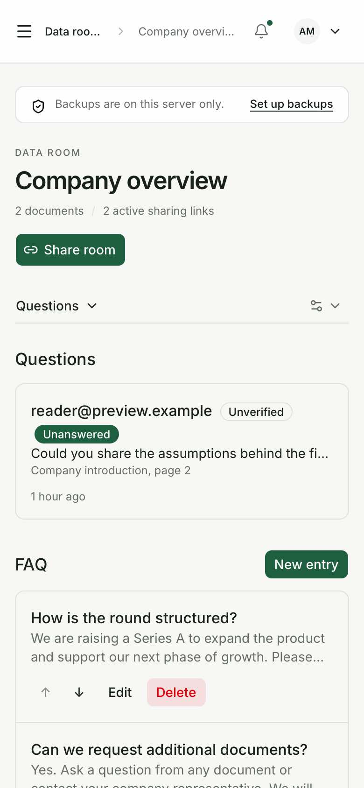

## Request a file

Use **File requests → New request** for an investor, link or group. Set the requested document,
instructions, maximum size and an optional due date. The investor sees the request in their room
and uploads through it. Uploaded files stay outside the shared documents and are downloads for
members only. Close a request to stop new uploads. Late submissions remain marked.

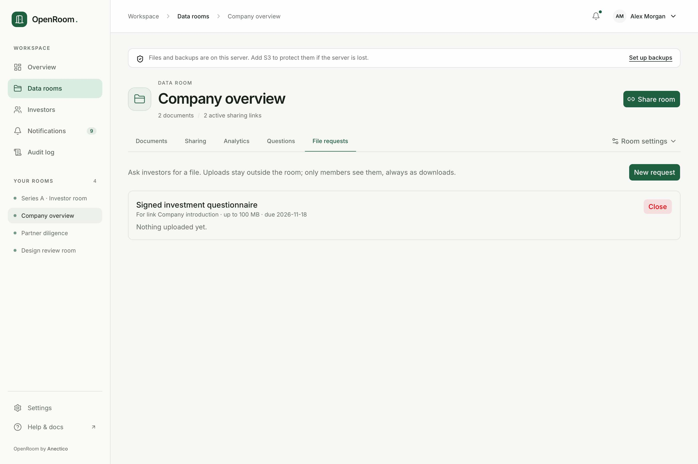

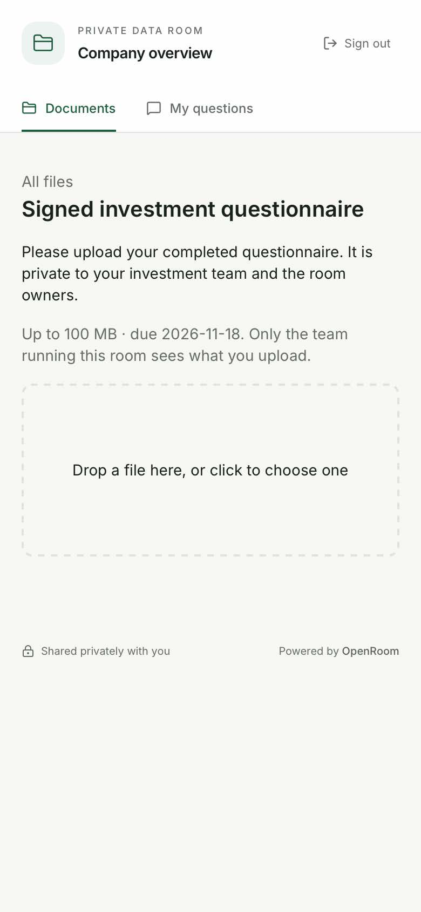

## Personalize the room

Open **Room settings & branding** to edit the room name, welcome introduction, logo and brand colour.
Preview Documents or Entry screen at desktop/phone widths, then **Save appearance** to publish the
changes together. **Cancel changes** discards your draft. Reset either logo or colour to inherit the
workspace setting. Investor browser icons follow the effective logo.

The introduction supports Markdown and remains available inside the room after entry. Investors can
open the full note from its two-line excerpt; their choice is remembered within the tab. The room name is the document page's heading.
See [workspace settings](settings.md) for inheritance, white labeling and preview details.

### A personal welcome for an investor or audience

In **Share room**, or when editing an existing link in Sharing, expand **Personal welcome**.
Write up to 4,000 characters of Markdown and switch between **Edit** and **Preview** before saving.
On phones the editor fills the screen, with a scrolling body and persistent Save/Cancel controls. Everyone
using that link sees the same note after completing all access checks. Use separate links for
different messages. The note replaces the room introduction inside the room; the general room
introduction remains on the entry screen. Leave the field blank or choose **Use room introduction**
to restore the room introduction. Cancel discards edits; a failed save keeps the draft available.

### Choose where investors start

On the room's Documents page, choose **Choose documents** in **Start here**. Select up to six files,
use the up/down buttons to set their reading order, then **Save Start here**. Later, use **Manage
pinned documents** to change or clear the list. Search includes files in every folder. Refresh the
document list if someone has uploaded or deleted a file while the editor is open.

Pins are shared across the room. Each investor sees only pinned files their link can access;
pinning never grants access or reveals a hidden file's title. The section disappears if none are
visible. Cards open the document viewer or download a download-only file. The reading list appears
at the document root and hides while searching or browsing folders. Preview each restricted link
to check its note and visible reading order before sharing.

Renaming, moving or uploading a new version keeps a document pinned. Deleting a document removes
its pin. Room duplication copies the reading order using the new document IDs; it does not copy
sharing links or personal notes. Owners and admins can edit these settings; observers can view them.

## Finish a deal and manage privacy

Room settings can duplicate a room's structure, current files, groups, defaults, NDA and branding.
Links, investors and activity are not duplicated. Shared document objects are reference counted.

**Freeze room** is permanent: links are revoked, requests close and the room becomes read only.
OpenRoom builds an archive with files, index, activity, questions, audit and a SHA-256 manifest.
The frozen-room banner shows progress, download or retry. Retention defaults to 730 days and can
be changed within the allowed range. NDA evidence is retained separately.

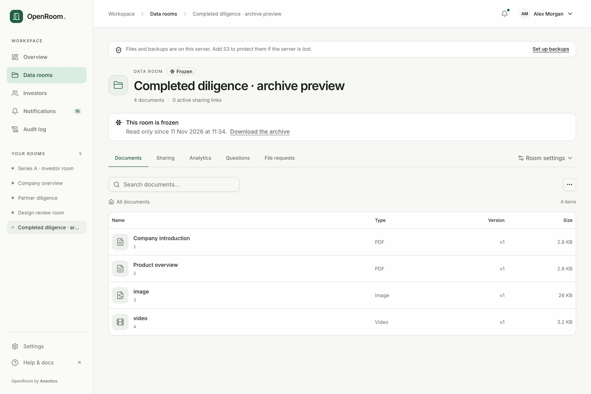

The investor page can export that investor's data or erase their live data after confirmation.
Erasure has documented exceptions for NDA evidence, hashed blocks and retained backup bytes. Read
[privacy and erasure](privacy.md) before confirming. Deleting a room/file removes live access at once;
retained file cleanup follows the database recovery window described in [storage and backups](storage-and-backups.md).

## Team and automation

[Workspace settings](settings.md) covers branding, email, members, API keys and webhooks. Notifications
have per-member email preferences. Question notices open the specific conversation and upload
notices open and highlight the relevant file request. These destinations are also used in email
notifications. If an old notice no longer has a matching item, it opens the room’s questions or requests list. The audit log lists changes by member/key/surface and supports
filters and CSV export; it cannot be edited through the app.

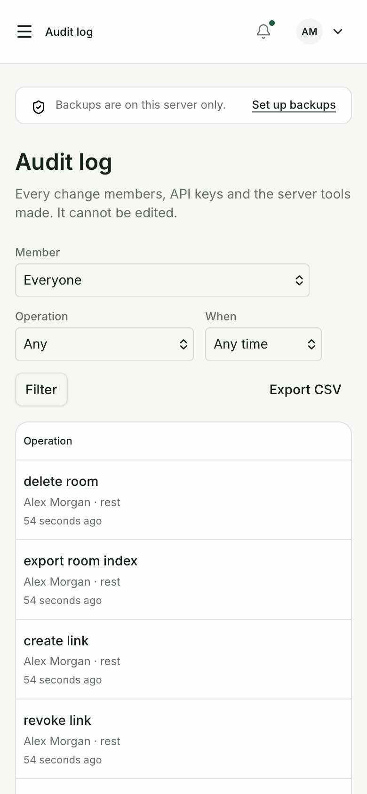

An agent or script can perform the same operations through [MCP, REST or the CLI](cli.md). The
[agent skill](../skills/openroom/SKILL.md) links installation, sharing, follow-up and recovery runbooks.

## Catch up on a returning visit

Returning investors can select the **changed documents** count and see **New** or **Updated**
documents. The first visit starts a baseline; a return after 30 minutes away from the document list,
or a new verified session, compares against the previous visit. Only permitted files appear.
Unverified visitors keep this history in their current session.

**My questions** shows unread team replies. Opening a reply where it is visible clears its unread
indicator; Awaiting answer and Replied still describe who wrote last. No read receipt is sent to the team.

Requests show **Action needed**, **Uploaded** or **Closed**. A successful upload displays a receipt,
and previous submissions remain available after reload and after closure. Uploaded confirms delivery,
not review or approval. Other unverified sessions cannot see those submissions.

Inside a PDF, **Find** searches words and phrases with page results and highlighting. **Pages** opens
thumbnails in groups of eight. Text can be selected and is exposed to assistive technology when the
PDF contains text. Scanned PDFs without text need OCR outside OpenRoom before they can be searched.

## Keep your review moving

Your home brings changed documents, unread replies and requests needing action together. The welcome
note collapses after you have seen it in this tab; an explicit open/closed choice is remembered until
the note changes. Continue reading stays near the top.

Use **Mark reviewed** on a Start here document when you decide you have finished reviewing it.
The separate **Undo** action beside **Reviewed** reverses the choice. Before you begin, a compact document count and **Start review** point to the first item. Once you
mark a document reviewed, a short progress bar and **Continue review** help you pick up the remaining materials. Opening a file does not mark it reviewed. A new current version starts unreviewed.
Verified investors keep their checklist across verified sessions; unverified visitors keep it only in
their current session. It is a personal checklist, not team approval or a read receipt.

**Requests** shows outstanding items in due-date order. Open **Submissions & history** for submitted
or closed items. You can still add files to a submitted request while it remains open.

On phones, PDF zoom controls are in **Zoom options**. **Pages** opens a scrollable thumbnail dialog
with pagination kept in view. Selecting a Find result closes the dialog and keeps result navigation
beside the reading controls. Reopen Find to see the selected result; clear search to remove highlights.

Conversation page references take you to that page in the current authorized document. Replies show
local timestamps and save draft text in this tab through reloads. Drafts clear after a successful send
or sign-out. If delivery cannot be confirmed, check the conversation before retrying.

Reviewed Start here documents now move into **Show reviewed**, keeping remaining items prominent in
the team's original order. **All documents** in the Start here header goes directly to the folder list. The welcome's
open/closed choice stays stable while review progress and counts refresh. When a previously reviewed
file changes version, **New version — review again** explains the reset with the version/date.

At the end of a PDF, use the completion panel to mark it reviewed, continue through Start here or
return to your document list. Reopened PDF tools reveal the current thumbnail or selected search
result and retain their own scrolling. Conversations offer shortcuts to unread replies, the latest
reply and your draft; long URLs wrap within the page. Page references open the current document.

Successful uploads put the receipt first, including after reload. **Add another file** remains
available while the request is open. Returning through **Back to requests** highlights your submitted
request and opens its history; outstanding requests remain listed first.

## Clearer reading and submission controls

Start here uses compact rows on phones and tablets, with document titles emphasized and a separate
**Review** action. Desktop cards keep the same reading order. Search fills the phone width; the
document heading changes to the current folder or Search results. Questions and document downloads
stay within the document flow: **My questions** (or the unread reply count) sits beside search,
and ZIP downloads appear below the list when permitted. Documents use the full content width without
a separate tools column. File format, size and section share a compact metadata line.

Request badges use both icons and words: amber **Action needed**, green **Uploaded**, and neutral
**Closed**. Uploaded confirms receipt only. The newest receipt appears once; **Previous submissions**
expands earlier uploads with dates formatted consistently. Closed requests show a compact notice.

Conversation sender names are prominent and **New replies** separates unread replies from earlier
messages. On narrow phones the shortcuts shorten to Unread, Latest, and Reply or Draft. PDF Pages
marks the current page with a check and **Current**; amber text matches remain distinct from the
selected result. The completion panel separates Reviewed/Undo from the primary next-document action.

The home attention counts are clickable chips. **Mark reviewed** is separate from opening a document;
completed items show **Reviewed** with a separate **Undo** action. Document rows show format and size
on phones too, with the outline position explicitly labeled **Section**.

The sharing-link editor asks before discarding unsaved changes when closing, cancelling or pressing Escape. Choose **Keep editing** to retain the draft, or **Discard changes** to restore saved values on the next edit. Leaving or reloading the page also warns about unsaved changes. Drafts are not stored in browser storage. Mobile sharing rows retain email verification, NDA, password and watermark context before you copy a link.

## Reliable submissions and recovery

A document question keeps its original page when you close and reopen the draft. Opening another document starts a new draft. If access changes before sending, OpenRoom keeps the text and explains that the question was not sent. Only a confirmed stored question displays **Sent**.

Sign-in, password setup and password change retain entered values after a connection failure so you can retry. Failed reset requests show an error instead of a sent confirmation. Returning investors see an NDA-change notice only when the accepted version differs from the current version; required acceptance still applies.

Sharing-link fields are disabled while saving. Destructive confirmations stay open and cannot be cancelled once their request is in progress. Observer accounts do not get retention-editing controls.

Video buttons and sliders retain their native keyboard behavior, and phone seek controls have a full-width row. Reading analytics account for visible time before a tab hides and resume when it becomes visible. Closing PDF tools opened from **Reader options** returns focus to that menu button.
