# Use OpenRoom

OpenRoom lets your team share documents through personal investor links and understand how the
materials were read. The [install guide](agents/install.md) gets the first owner signed in. Email,
S3 and webhooks are optional; a new install works on its own server's disk.

## Your workspace

The overview shows rooms, recent activity and setup items. A new workspace starts with three steps:
**Create a room**, **Upload documents** and **Send your first link**. **Needs attention** lists what
is waiting for you, oldest first, each with a link to it: questions where the investor wrote last,
file requests that are overdue or have uploads to review, and active links nobody has opened two
days after they were sent or created. Frozen rooms are left out. The **Awaiting answer** and **File
requests to review** tiles count the same items.

The sidebar takes you to all investors, notifications and the audit log. Its rooms show the same
counts; **All rooms** opens the full list and **User guide** opens this guide. The breadcrumb reads
Data rooms › room › section. On a phone, open the menu in the header. Choose **Light**, **Dark** or
**System** in the account menu; the choice applies to the admin pages only, never to the investor room.

Without S3, one amber line says files and backups are on this server, with **Set up** and **Hide for
now** (hidden until you close the tab). A red notice appears when the disk is nearly full, or when
the app runs under the launcher and database replication has not been confirmed recently.
The current-viewers panel refreshes every 15 seconds while Overview is visible, shows its last update,
and keeps the last known activity with an updates-paused message if the connection fails. Use its
refresh button to check immediately; returning to the tab or reconnecting also refreshes it.

On a phone, the overview keeps a compact summary above the room list. Room pages keep Share and
the section selector within reach, with document actions sized for touch.

A room has six tabs: **Documents**, **Sharing**, **Analytics**, **Questions**, **File requests** and
**Settings**. Questions and File requests show how many items need attention. Settings holds
**General** (appearance, duplicate, freeze, delete), **Groups**, **Link defaults** and **NDA**.

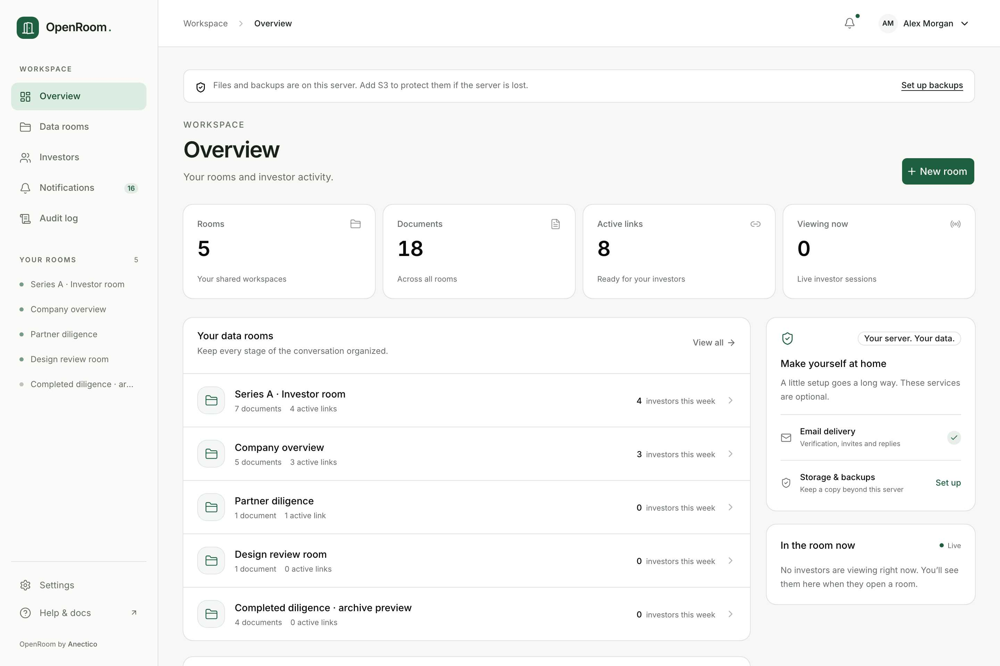

## Rooms, folders and documents

Create a room from **Data rooms → New room**. On the Documents page, **Room setup** lists three
steps: upload documents, create a sharing link and, optionally, pin a starting document. Each step
opens its action. The checklist disappears once the room has documents and an active link; **Dismiss**
hides it sooner and is remembered in this browser.

Use **Upload documents**, upload a folder from Document
options, or drop files and folders into the document list. Open folders to browse them and use search to find a
title anywhere in the room. Dropped folders retain their hierarchy and empty subfolders, including
when a folder contains more than 100 entries. Hidden files and folders are skipped. **Import from a URL** copies a
direct public HTTPS file; private networks and redirects are refused.

The upload tray stays available when you move between workspace pages. Minimize it to keep working;
expand it to see file names, destinations and failures. Completed batches collapse to a receipt that
can be dismissed. **Retry failed** sends the failed files again; clearing the receipt keeps uploaded
documents. A lost connection keeps the retry controls on screen.

The list shows when each document was last updated and how many investors opened it; the
**Investors** count opens Analytics filtered to that document. Each row's menu can rename, upload a
new version, delete, or **Move or reorder…** into a folder at a chosen position. Tick several rows to
**Move…** or **Delete…** them together. **Versions** lets you make an earlier version current.
Deletion first explains its effect and asks you to confirm. The original
file type is detected from its bytes. PDFs, images and browser-supported video have an inline viewer;
other types are download-only. See [viewer behavior](contributing/viewer.md) for the limits.

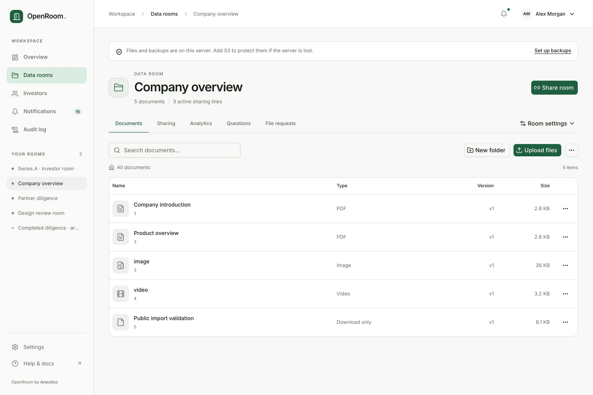

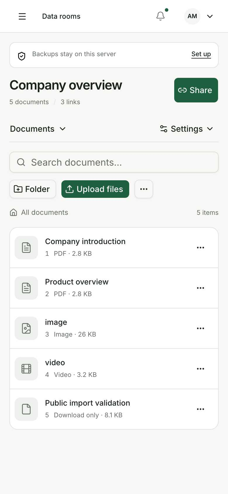

Export an index as PDF or CSV from Document options. **Download whole room as ZIP** is there too; the
status shows while the archive is being prepared. Large exports need free space on the server even
when documents live in S3.

## Share with the right people

Open a room and choose **Share room** (or **Share** on a phone). Give it a label and choose approved email addresses or domains, or make
it open. Each link has its own URL, optional password and expiry. A link stops working at the end of
its expiry day in the workspace time zone. Copy its URL directly from the list. After creating a link, review its audience, document group, protection, downloads and expiry
in the completion dialog. Generating a replacement address shows the same access summary.
In the Sharing list, the Protection column shows whether visitors must enter an email code. Password, NDA and watermark requirements appear underneath when enabled. **Copy link** and **Preview as investor** are available immediately.
Search links by name or allowed email, sort them by **Last opened**, **Created** or **Investors**, and
filter to links **Never opened**. Select a link's name to edit it. **Duplicate…** opens the editor
with a copy of a link's audience, group and settings under a new address. The password is never
copied, and a past expiry date and blocks on erased investors are dropped.
**Email invitation** appears when email is configured and the allow list contains individual email
addresses; clicking it queues invitations and reports any skipped addresses. Domain entries are not
emailed. Creating the link alone never sends an invitation.

Links inherit **Settings → Link defaults** unless they override a field. Choose email
verification and NDA requirements under **Investor access**. **Document protection** controls
watermarks, screenshot protection and downloads. Add up to five entry questions and choose which
are required. Under **Activity tracking**, set the reading threshold and visit notifications.
**Save defaults** applies edited settings to links that inherit them. When a change to email
verification, NDA, watermark, screenshot protection or downloads reaches active links, OpenRoom names
those links and asks you to confirm with **Save and apply**. **Discard** restores the saved values.
In the link editor, **Email verification** sits below the audience choice. **Room default** shows
the inherited value. When a provider is missing, owners can select **Set up email provider**,
configure delivery in the new tab, then return to the draft and choose **On**.
Connecting a provider leaves the room’s saved default and the link’s selection in effect.
Without verification, an email is a claimed identity. A link that requires verification refuses
entry if email delivery is unavailable. Changing a password ends existing investor sessions;
revocation, allow/block rules, verification and expiry are checked on subsequent requests.

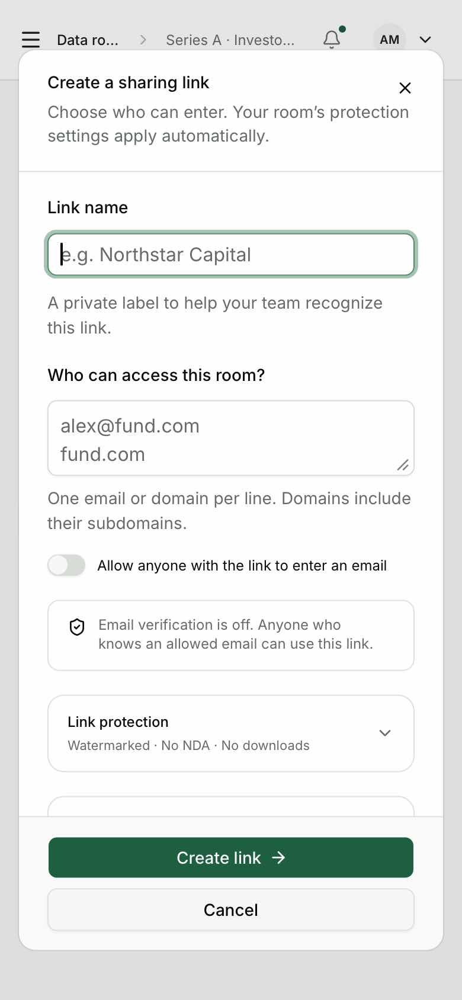

Use **Settings → Groups** to limit an audience to selected folders or
files. A group has a default access choice; folders pass their choice to descendants unless a child
overrides it. New items inherit those choices. Each item says where an inherited choice comes from,
folders can be collapsed, and each change shows when it is saved. Attach the group in the link editor. A link with no
group sees the whole room, including future documents. **Document access** is always visible in
the link editor. Expand **Choose specific documents** and use **Manage groups** to open group management in another tab.
Return to the draft, use **Refresh groups**, and select the intended group. Download-only files remain
downloadable even with **No downloads**; hide them with a group when necessary. Use **Preview group** beside an active link on the group page, or preview
the link from Sharing, before sending it. A group needs an active sharing link to preview its
permissions together with the link's protection settings.

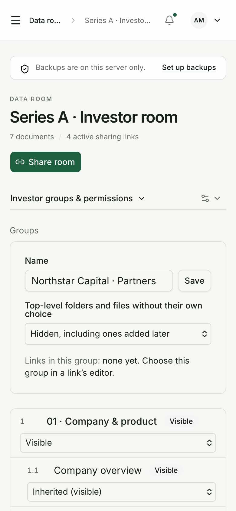

## NDA and the investor experience

Publish your approved agreement under **Settings → NDA**, then enable the NDA requirement in
defaults or a link. Switch between **Edit** and **Preview** while writing. The page says how many
active links require the NDA. Publishing a replacement requires affected investors to accept the new
version. Earlier versions open read only; **Copy into the editor** starts a new draft from one. Acceptance records retain the version, signed name, email, verification
state, time and IP according to the documented privacy rules. Without published NDA text, the link
editor offers **Set up the NDA** in a new tab.

Investors follow their link and pass the configured gates one step at a time. The gate shows **Step
n of N** and, on wider screens, the steps ahead. **Shared by** shows the display name of the email
sender (`Acme <rooms@acme.com>` shows "Acme"); without one the line is hidden. The first step lists
**What this room records**, built from the link's settings: email, IP and browser, pages and time,
downloads when allowed, the watermark and screenshot protection when on. An email code is valid for
10 minutes; the field accepts one-time-code autofill and continues by itself at six digits. A gate
left for 30 minutes times out and asks the investor to start again. On the NDA step the agreement
flows with the page on phones, **I have read and agree to this NDA** confirms acceptance, and
**Download a copy** saves the text as Markdown.

When a session has ended, opening a room address from an email (an answer, a file request, a
document) remembers that page for an hour; after the gate the investor lands there instead of the
document list. Emails say so. **Sign out** ends the session and shows a signed-out page.

The room footer repeats **What this room records** as a collapsible list, shows **Access until** when
the link expires and offers **Your NDA**, the version this session accepted. A page that is no longer
available, such as a removed document or a closed request, says what is missing and links back to
Documents, Questions or Requests.

Investors then enter the document list. A compact header shows the room title, logo and account controls throughout the investor room. A first-visit dialog presents the optional welcome and cover after access checks. **Start reading**
opens the first pinned document, or the first readable one, and **Browse documents** closes the
dialog. It never opens over the document reader. A room with one visible document opens with its title and an **Open document** or **Download file** action. In larger rooms, **Start here** features the first outstanding recommendation and shows the remaining documents in reading order, with cards side by side on wider screens and a single list on phones. On phones, **Show all recommended documents** expands longer lists.
**All documents** uses the same responsive layout for folders and files. Folder cards show the item count. File cards show the file type and size. Section numbers reflect the contents visible through the current sharing link. Document rows show
**Updated** with the date of the current version, and **Download all as ZIP** sits in the All
documents header when the link allows it. Opening a document
and using its return link restores the folder and scroll position. A document opened from
Start here follows that reading order with Previous/Next controls, respecting current permissions.

**Continue reading** returns to the last PDF page saved in this browser tab. Reopening a PDF restores
the page saved in the tab, or else the last page this investor read of the current version on the
server (a verified investor across sessions and devices; an unverified one in this session only).
The toolbar then shows **Resumed at page N · Start from page 1**. A new document version starts at
page one. **Fit width** resets PDF zoom.

Document and PDF navigation controls
have larger touch targets. The PDF viewer
supports paging, zoom, fit and page jumps. On a phone the PDF reader takes the whole screen with one
bar: back, title, page n of N and a menu with Find, Pages, Full screen, Zoom, Ask, Download and
Previous/Next. A floating zoom control stays in the corner, and pages are drawn sharply again after
zooming or pinching. On wide screens landscape pages grow up to 88rem. If a document cannot load,
the reader says why: a connection problem offers **Try again**, an ended session says to open the
invitation link, a new version offers **Reload**, and other failures offer **Download** when allowed.
Download checks the version first and offers **Reload** when it changed.

Its watermark shows the investor identity and scales with the page. With screenshot protection, the
document is hidden as soon as the tab is hidden, or after 1.5 seconds without window focus, with a
message to return to the window. Screenshot protection is best effort; a browser cannot prevent
someone photographing a screen. Downloads obey the link's current mode: no downloads, individual
documents or one ZIP of allowed documents. ZIP preparation shows progress and then a **Save ZIP** action. A connection failure shows **Retry ZIP**;
retrying an interrupted status check continues the existing job. Leaving the page stops its polling.

Video controls are 44 px on phones. Where the browser has no full screen for the player (iPhone),
**Full screen** fills the window instead. The player shows when it is buffering or cannot play, and
its keyboard shortcuts work after you click it.

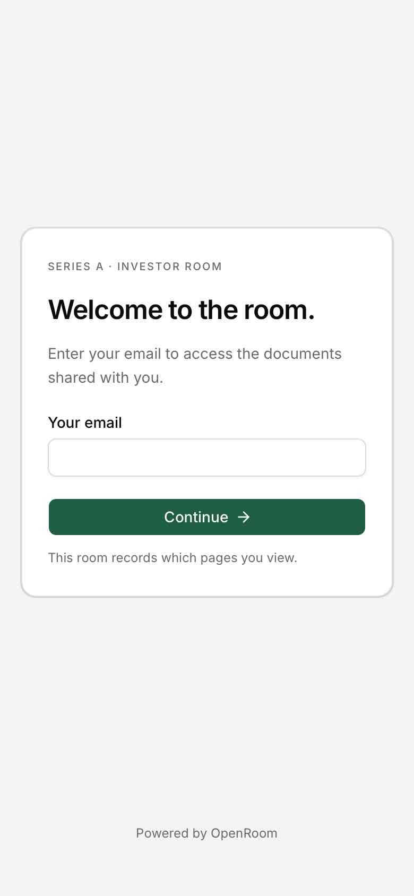

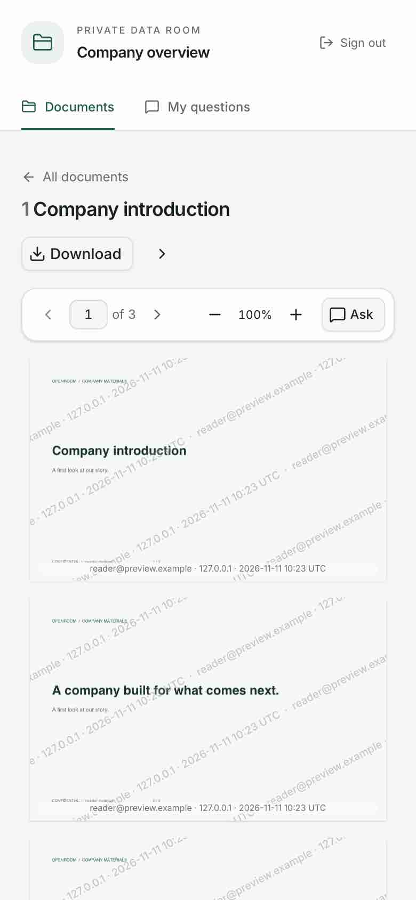

## Activity and investors

**Analytics** has **Investors**, **Firms**, **Documents** (page reading and video coverage),
**Timeline** and, for admins and owners, **Not opened yet**: the emails on active links' allow lists
that never entered the room. The selected view stays in the address. Investor columns sort by
reading time (the default), visits, documents, downloads or last seen; unverified investors with no
reading time are collected in one collapsed "N investors opened but didn't read" line.
The totals at the top follow the applied time, sharing link and group filters. **Filter** and
**Clear filters** keep the selected report open. **Export CSV** downloads that report with its applied filters.
Reading time estimates active foreground
viewing, not a guarantee that someone understood a page. Unverified viewers remain labeled.
The workspace Investors page combines activity across rooms and filters as you type. Its block list
takes an email or domain with **Block**; each row has **Unblock**. An investor's profile has an
**Access** section listing their links with how they are allowed, the group, status and last visit.
**Remove from link** stops them entering through one link and ends their sessions on it: their email
leaves the allow list when other entries remain, otherwise (or on an open or domain link) their email
is blocked on that link. **Block from all rooms** adds an install-wide block; **Unblock** removes it.
Under **Documents read**, select **Reading details** to see each version, time on each page and the
video segments watched across that investor's visits. Older versions remain separate from the
current document. Deleting a file removes that file's reading activity along with its live versions.

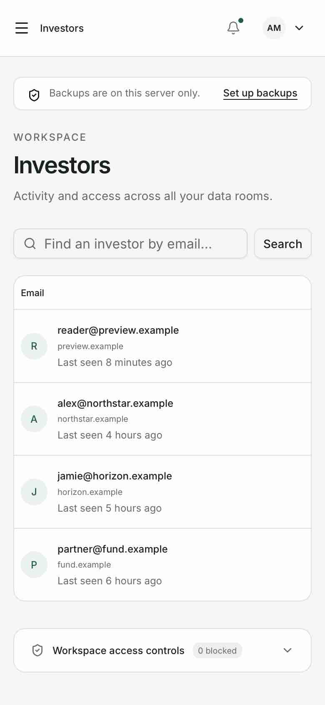

## Questions, answers and FAQ

Investors can use **My questions → Ask the team** to ask about the room or select a document.
They can also ask from a document page. Conversations show **Awaiting answer** after the investor's
latest message and **Replied** after the team's latest response; these are reply states, not read
receipts. Connection failures keep the question draft available for retry. Document choices include
only files the current link permits. Investors return to the conversation under My questions. Members reply
from **Questions → Investor conversations**. Use **Awaiting answer** to find conversations that need a reply.
Verified investors can return across their verified sessions;
unverified conversations stay with the original session. Email replies are optional.

Entries under **Room FAQ** appear to every investor in the room. Use them for approved general answers, rather
than copying a private answer into the FAQ without considering its audience. Investor text is
always shown as plain text. Owner Markdown permits formatting and safe external links, with HTML
disabled.

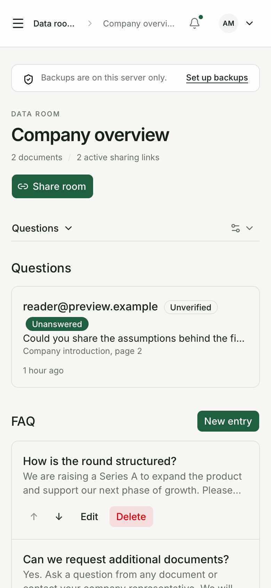

## Request a file

Use **File requests → New request** for an investor, link or group. Set the requested document,
instructions, maximum size and an optional due date. The deadline is the end of that day in the workspace time zone.
Each request lists its recipient and submissions, including the uploader and file size. The investor sees the request in their room
and uploads through it. Investors can pick several files at once; each shows its own progress and
**Cancel**, and leaving the page during an upload asks first. The maximum size applies to each file.
Uploaded files stay outside the shared documents and are downloads for
members only. Close a request to stop new uploads. Late submissions remain marked.

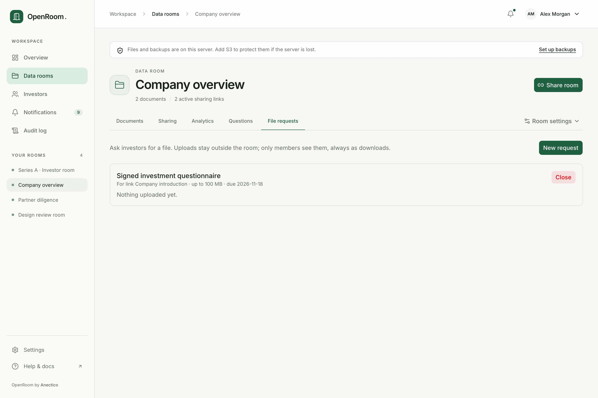

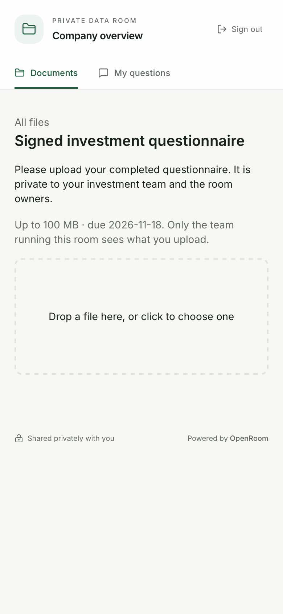

## Personalize the room

Open the room's **Settings** tab. Under **General**, use **Room appearance** to edit the room name, welcome introduction, logo, optional cover image and brand colour. Use public artwork for the cover.
Preview your room’s documents, pins, FAQ and email entry at desktop or phone widths. Choose **Save appearance** to publish the
changes together. **Cancel changes** discards your draft. Reset either logo or colour to inherit the
workspace setting. Investor browser icons follow the effective logo.

The investor header gives your logo a prominent place alongside the room identity. Your brand colour
also accents the room header, navigation and primary actions. Select text to make it bold, italic, colored, or linked. Use **Heading** or **Subheading** to change the size of a paragraph, and the list buttons for reading steps. Select **Markdown** to edit the source. The introduction appears in a first-visit dialog. Choose **Start reading** or **Browse documents**
(**Enter room** when nothing can be read in the browser) to dismiss it. Later visits through the same link in this browser go directly to the room.
See [workspace settings](settings.md) for inheritance and preview details.

### A personal welcome for an investor or audience

In **Share room**, or when editing an existing link in Sharing, expand **Personal welcome**.
Use the same formatting toolbar as the room welcome. The limit is 4,000 characters including formatting. Switch between **Edit** and **Preview** before saving.
On phones the editor fills the screen, with a scrolling body and persistent Save/Cancel controls. Everyone
using that link sees the same note after completing all access checks. Use separate links for
different messages. The note replaces the room introduction in the welcome dialog. Leave the field blank or choose **Use room introduction**
to restore the room introduction. Cancel discards edits; a failed save keeps the draft available.

### Choose where investors start

On the room's Documents page, upload a file, then choose **Pin a starting document** in **Room setup**. Select up to six files,
use the up/down buttons to set their reading order, then **Save Start here**. Later, use **Manage
pinned documents** to change or clear the list. Search includes files in every folder. Refresh the
document list if someone has uploaded or deleted a file while the editor is open.

Pins are shared across the room. Each investor sees only pinned files their link can access;
pinning never grants access or reveals a hidden file's title. The section disappears if none are
visible. Cards open the document viewer or download a download-only file. The reading list appears
at the document root and hides while browsing folders. Preview each restricted link
to check its note and visible reading order before sharing.

Renaming, moving or uploading a new version keeps a document pinned. Deleting a document removes
its pin. Room duplication copies the reading order using the new document IDs; it does not copy
sharing links or personal notes. Owners and admins can edit these settings; observers can view them.

## Finish a deal and manage privacy

**Settings → General** can duplicate a room's structure, current files, groups, defaults, NDA and branding.
Links, investors and activity are not duplicated. Shared document objects are reference counted.

**Freeze room** is permanent: links are revoked, requests close and the room becomes read only.
OpenRoom builds an archive with files, index, activity, questions, audit and a SHA-256 manifest.
The frozen-room banner shows progress, download or retry. Retention defaults to 730 days and can
be changed within the allowed range. NDA evidence is retained separately. **Delete room…** asks you
to type the room's name before it deletes anything.

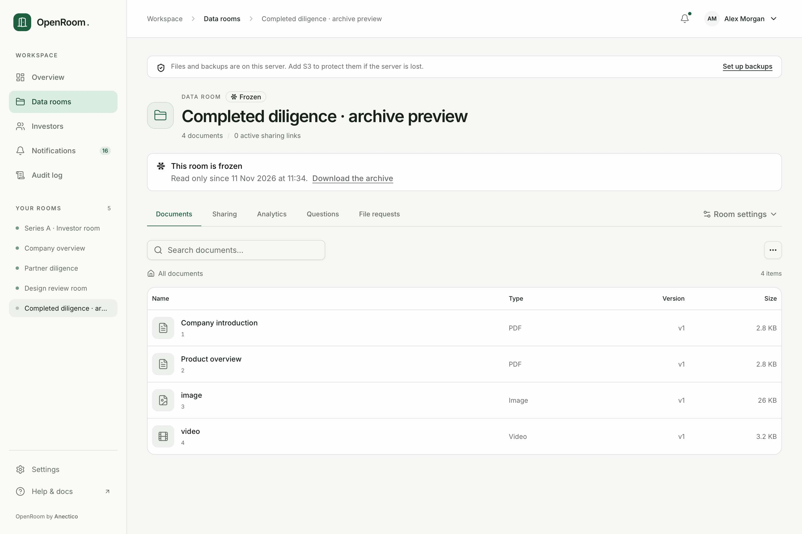

The investor page can export that investor's data or erase their live data after confirmation.
Erasure has documented exceptions for NDA evidence, hashed blocks and retained backup bytes. Read
[privacy and erasure](privacy.md) before confirming. Deleting a room/file removes live access at once;
retained file cleanup follows the database recovery window described in [storage and backups](storage-and-backups.md).

## Team and automation

[Workspace settings](settings.md) covers branding, email delivery, members, API keys and webhooks.
Under **Members** you cannot change your own role; making someone an owner, lowering a role and
cancelling an invite each ask you to confirm.
The header bell opens your five latest notices. Choose a notice to open it and mark it as read,
or select **View all notifications** for the inbox. Choose **Unread** to focus on new notices. Open a notice to visit its destination, or use its checkmark to mark it as read in place. **Mark all as read** clears your unread count.
Choose which notices send you email in **My account → Email preferences** or follow the
**Email preferences** link from Notifications. Question notices open the specific conversation and upload
notices open and highlight the relevant file request. These destinations are also used in email
notifications. If an old notice no longer has a matching item, it opens the room’s questions or requests list. The audit log lists changes by member/key/surface and supports
filters and CSV export; it cannot be edited through the app.

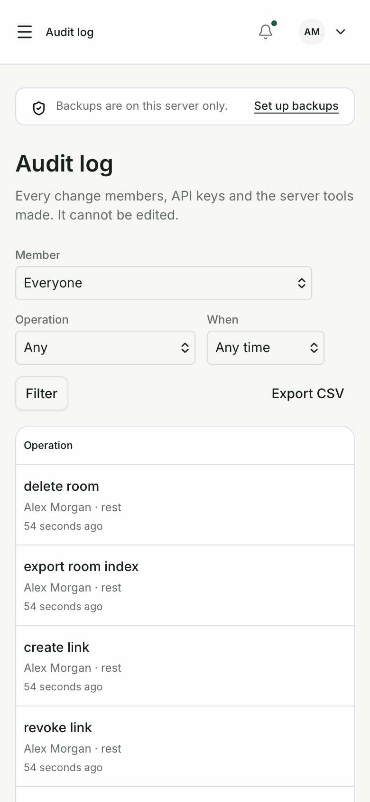

An agent or script can perform the same operations through [MCP, REST or the CLI](cli.md). The
[agent skill](../skills/openroom/SKILL.md) links installation, sharing, follow-up and recovery runbooks.

## Catch up on a returning visit

Returning investors can select the **changed documents** count and see **New** or **Updated**
documents. The first visit starts a baseline; a return after 30 minutes away from the document list,
or a new verified session, compares against the previous visit. Only permitted files appear.
Unverified visitors keep this history in their current session.

**My questions** shows unread team replies. Opening a reply where it is visible clears its unread
indicator; Awaiting answer and Replied still describe who wrote last. No read receipt is sent to the team.

Requests show **Action needed**, **Uploaded** or **Closed**. A successful upload displays a receipt,
and previous submissions remain available after reload and after closure. Uploaded confirms delivery,
not review or approval. Other unverified sessions cannot see those submissions.

Inside a PDF, **Find** searches words and phrases with page results and highlighting. **Pages** opens
thumbnails in groups of eight. Text can be selected and is exposed to assistive technology when the
PDF contains text. Scanned PDFs without text need OCR outside OpenRoom before they can be searched.

## Keep your review moving

Use **Back** beside a folder name to return to the list where you opened it, at the same scroll position. When you open a folder from a direct link, **Back** takes you to its parent. The library shows changed documents, and the **Questions** and **Requests** links show counts for unread replies and requests needing action. Continue reading stays near the top.

Choose **Full screen** in a PDF or image viewer to use the whole display. In a pitch deck, use the arrow keys or page buttons to advance one slide at a time. **Exit full screen** returns you to the same page.

Use **Mark reviewed** at the end of a recommended document’s reader. The footer names the next document in reading order and includes a link back to the library or folder. For a download-only file, the action is on its recommended card. Open **Reviewed** to revisit completed items. **Undo** in the reader or on a download-only item reverses the choice. A new file version can be reviewed again.
On return, an available PDF reading position takes precedence over the next recommended file. **Resume on page…** opens that page. The remaining recommendations appear below.
Verified investors keep their checklist across verified sessions; unverified visitors keep it only in
their current session. It is a personal checklist, not team approval or a read receipt.

**Requests** shows outstanding items in due-date order. Open **Submissions & history** for submitted
or closed items. You can still add files to a submitted request while it remains open.

On phones, PDF zoom is in the reader menu and the floating zoom control. **Pages** opens a scrollable thumbnail dialog
with pagination kept in view. Selecting a Find result closes the dialog and keeps result navigation
beside the reading controls. Reopen Find to see the selected result; clear search to remove highlights.

Conversation page references take you to that page in the current authorized document. Replies show
local timestamps and save draft text in this tab through reloads. Drafts clear after a successful send
or sign-out. If delivery cannot be confirmed, check the conversation before retrying.

Reviewed Start here documents now move into **Reviewed**, keeping remaining items prominent in
the team's original order. **All documents** in the Start here header goes directly to the folder list. When a previously reviewed
file changes version, **New version — review again** explains the reset with the version/date.

At the end of a PDF, use the completion panel to mark it reviewed, continue through Start here or
return to your document list. Reopened PDF tools reveal the current thumbnail or selected search
result and retain their own scrolling. Conversations offer shortcuts to unread replies, the latest
reply and your draft; long URLs wrap within the page. Page references open the current document.

Successful uploads put the receipt first, including after reload. **Add another file** remains
available while the request is open. Returning through **Back to requests** highlights your submitted
request and opens its history; outstanding requests remain listed first.

## Clearer reading and submission controls

The **All documents** heading changes when browsing a folder. **Questions** and **Requests** are available in the main navigation. Unread replies and outstanding requests have shortcuts beside the library. Permitted ZIP downloads sit in the All documents header. File format, size and section share a compact metadata line.

Request badges use both icons and words: amber **Action needed**, green **Uploaded**, and neutral
**Closed**. Uploaded confirms receipt only. The newest receipt appears once; **Previous submissions**
expands earlier uploads with dates formatted consistently. Closed requests show a compact notice.

Conversation sender names are prominent and **New replies** separates unread replies from earlier
messages. On narrow phones the shortcuts shorten to Unread, Latest, and Reply or Draft. PDF Pages
marks the current page with a check and **Current**; amber text matches remain distinct from the
selected result. The completion panel separates Reviewed/Undo from the primary next-document action.

The home attention counts are clickable chips. **Mark reviewed** is separate from opening a document;
completed items show **Reviewed** with a separate **Undo** action. Document rows show format and size
on phones too, with the outline position explicitly labeled **Section**.

The sharing-link editor asks before discarding unsaved changes when closing, cancelling or pressing Escape. Choose **Keep editing** to retain the draft, or **Discard changes** to restore saved values on the next edit. Leaving or reloading the page also warns about unsaved changes. Drafts are not stored in browser storage. Mobile sharing rows retain email verification, NDA, password and watermark context before you copy a link.

## Reliable submissions and recovery

A document question keeps its original page when you close and reopen the draft. Opening another document starts a new draft. If access changes before sending, OpenRoom keeps the text and explains that the question was not sent. Only a confirmed stored question displays **Sent**.

Sign-in, password setup and password change retain entered values after a connection failure so you can retry. Failed reset requests show an error instead of a sent confirmation. Returning investors see an NDA-change notice only when the accepted version differs from the current version; required acceptance still applies.

Sharing-link fields are disabled while saving. Destructive confirmations stay open and cannot be cancelled once their request is in progress. Observer accounts do not get retention-editing controls.

Video buttons and sliders retain their native keyboard behavior, and phone seek controls have a full-width row. Reading analytics account for visible time before a tab hides and resume when it becomes visible. Closing PDF tools opened from **Reader options** returns focus to that menu button.
